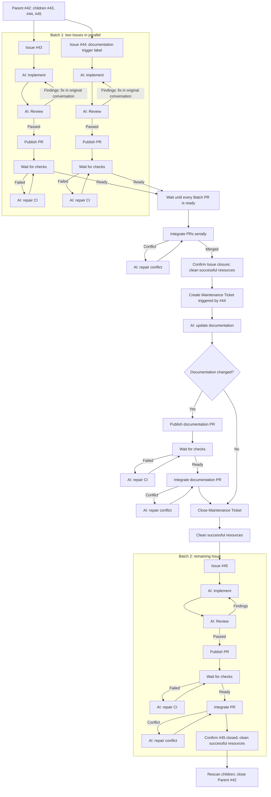

# Issue Runner Core

Issue Runner coordinates AI work on GitHub Issues: it selects eligible work, creates isolated Worktrees, verifies commits, publishes pull requests, waits for checks, and coordinates integration and Issue closure. AI handles implementation, Review, and repairs; Runner handles the workflow.

Core is a library. A terminal package owns the command and terminal I/O; [issue-runner-herdr](https://github.com/BuddyLabsCo/issue-runner-herdr) is the command-entry example below. Optional Agent enhancements add native readiness and recovery support.

Demonstration GIF remains outstanding. Missing inputs: the maintainer's screen recording and selected start/end time intervals showing Runner output, created terminal tabs, and AI conversations starting execution.

## Workflow overview

<details>
<summary>Expand the Parent Run workflow</summary>

Adapted from [Sandcastle Runner's workflow overview](https://github.com/BuddyLabsCo/sandcastle-runner#what-can-it-do). This example delivers three eligible children with two Issues per Batch and automatic documentation triggered by #44. Agent names come from your configuration; `AI:` marks Agent work.



Review can be disabled. An ordinary Issue with no changes receives no delivery credit; verified documentation with no changes closes its Maintenance Ticket without a PR. Unfinished work retains its resources.

</details>

## Prerequisites

Prepare these on the machine and in the shell that runs the terminal command:

- Node.js 22.18.0 or later and npm 11 or later, including subsequent major versions
- Git with Worktree support, configured author identity, and access to push to the repository
- GitHub CLI (`gh`) on `PATH`, with credentials that can read/write Issues, pull requests, and repository contents and observe required checks
- An absolute-path repository checkout with working Git/GitHub credentials
- An installed, authenticated Agent CLI for every configured role, with its own skills, native permissions, and required tools
- A supported terminal environment; follow the [native Herdr installation instructions](https://herdr.dev/tui/docs/install/) for the example command (the adapter targets Herdr 0.9.5)

Launch the example command inside a live Herdr pane, preserving that pane's inherited environment.

### macOS and Linux

Install those tools, then verify them in the shell inside your selected terminal:

```sh
node --version          # At least 22.18.0
npm --version           # At least 11
git --version
gh --version
herdr --version
codex --version         # Repeat for each Agent CLI you configure
export GH_TOKEN='your_github_token' # Use your local secret mechanism
npm install --global issue-runner-herdr # Installs Core transitively
```

### Windows

Install the same tools natively and reopen PowerShell so `PATH` changes take effect. Use shell syntax your terminal and Agent commands support:

```powershell
node --version          # At least 22.18.0
npm --version           # At least 11
git --version
gh --version
herdr --version
codex --version         # Repeat for each Agent CLI you configure
$env:GH_TOKEN = 'your_github_token' # Use your local secret mechanism
npm install --global issue-runner-herdr # Installs Core transitively
```

Keep credentials out of Git. The repository's automated matrix covers Ubuntu and Windows; it does not establish native macOS acceptance.

### Install the handoff skill

Install the bundled [issue-runner-handoff](skills/issue-runner-handoff/SKILL.md) skill for every Agent CLI used by Runner:

1. Locate Core under the globally installed terminal package. Start with `npm root --global`; Core can be nested at `issue-runner-herdr/node_modules/issue-runner-core` or hoisted into the global modules directory.
2. Copy Core's entire `skills/issue-runner-handoff` directory unchanged into each Agent's documented user skill directory. The result is `<agent-skills-directory>/issue-runner-handoff/SKILL.md`.
3. Reload skills or restart that Agent CLI and verify explicit invocation is available.

`init` creates Project files; it does not install this skill or authenticate Agents.

### Optional Agent enhancements

Base startup works without an enhancement. To add Codex-specific readiness, trust preparation, and recovery, install [issue-runner-agent-codex](https://github.com/BuddyLabsCo/issue-runner-agent-codex) in the same global npm prefix as Herdr:

```sh
npm install --global issue-runner-agent-codex
```

Use the same `--prefix` for both packages when using a custom prefix. Core discovers enhancements for configured Agent identifiers; incompatible contract versions fall back to base startup with a diagnostic. Broken installations fail startup. See the [discovery contract](docs/terminal-contract.md#enhancement-discovery-and-compatibility) for integration details.

## Getting started

Run these from the directory that will contain your Project:

```sh
issue-runner-herdr --help          # Command overview; -h also works
issue-runner-herdr --version       # Terminal command and loaded Core versions
issue-runner-herdr run --help      # Run selectors and options
issue-runner-herdr init --project my-project # Creates config and three prompts
```

Edit `my-project/config.yaml` using its comments, replace its placeholders, and adapt the Agent commands to your shell. The [shipped configuration template](templates/config.yaml) contains all field guidance. Edit the three Project prompts under `my-project/prompts/` for implementation, Review, and documentation instructions. Run from the same Launch Directory; Runner looks only in its selected Project child directory.

```sh
issue-runner-herdr run --project my-project --parent 42 # Deliver eligible children
issue-runner-herdr run --project my-project --issue 43  # Deliver one Issue
issue-runner-herdr run --project my-project --issue     # Use configured Issue List
issue-runner-herdr run --project my-project --issue 43 --no-auto-merge # Retain PR/work
issue-runner-herdr run --project my-project --document  # Create Maintenance Ticket
issue-runner-herdr run --project my-project --document --no-auto-merge # Retain doc PR
```

Auto-merge defaults on. `--no-auto-merge` applies to numbered Issues and standalone documentation; retained, unmerged work reports `incomplete`. Runner owns push, PR, integration, and tracker operations. Agents report local work through handoffs; a handoff alone does not establish delivery.

## Troubleshooting

Use the native Agent conversation for approvals, questions, and missing output. Use Runner's terminal for an Operator Pause.

### Operator Pause

Runner pauses when an operation needs a decision, such as exhausted API/Git retries, resource creation failure, uncertain command delivery, or rejected enhancement readiness. Inspect the reported target and any partial effects before pressing Enter to retry or continue. `q` or EOF cancels; Issue-scoped pauses also allow `s` to skip and retain that Issue's resources. Audit recovery retries logging only. Continuing an uncertain command does not replay it.

### Folder or hook trust blocks startup

Without an enhancement, Runner waits the base startup delay and sends an identity-only Session Probe. If folder trust, hook trust, or native permissions block the Agent, approve them in that Runner Tab. Conversation text cannot approve native dialogs. Complete native trust setup before retrying; Runner sends no missing-output reminders.

### Continue a stopped conversation

If the Agent stopped midway, ask it to `continue` in its existing Runner Tab, preserving the current task and handoff path. If Runner itself stopped, close leftover Agent tabs and stop their sessions before rerunning, retaining native history and working resources. Rerun the same command with unchanged arguments and configuration. Runner resumes saved native references in the original Worktrees; it does not adopt surviving tabs.

Changed command names, arguments, or configuration bytes select new progress. If Runner prints `unable to recover`, Enter restarts the affected Issue from implementation with fresh resources; `q` or EOF exits. Failed resources remain available. Inspect the `Retained` report and Project recovery files before manual cleanup.

### Request an omitted handoff

When the Agent finishes without a handoff, find the active absolute path in Runner's `handoff=` output or the task's `Handoff path:` line. Explicitly invoke the installed skill in that same native conversation using that Agent's skill syntax, for example:

```text
/issue-runner-handoff /absolute/project/handoffs/current-assignment.json
/issue-runner-handoff "D:\Runner Work\project\handoffs\current-assignment.json"
```

Pass the current output path verbatim, including quotes around spaces. If that invocation needs correction, invoke the skill again at the same path. Runner assigns a fresh path for later invocations and automatic corrections. The skill writes atomically and leaves the handoff unwritten while human action is required. Invalid handoffs get specific feedback; missing files cause no reminders.

## Developing Core

Install the locked dependencies and use the existing checks:

```sh
npm ci                   # Install development dependencies
npm run build            # Compile JavaScript and declarations into dist/
npm run typecheck        # TypeScript diagnostics
node --test tests/run/cli-startup.test.ts # One focused workflow file
npm run check            # Formatting, lint, and typecheck
npm test                 # Full suite, including package installation checks
npm run test:workflow    # Agent and application scenarios
npm run test:adapters    # External boundaries and real Git
npm run test:package     # Pack/install in isolated consumer and global prefixes
npm run verify           # Static checks and full suite
```

`npm pack` builds through `prepack`. To check an existing candidate without repacking, set `RELEASE_TARBALL` to its absolute path and run `npm run release:accept`.

Core exports `runCli` and `CliOptions` from `issue-runner-core/cli`, and Terminal/Enhancement contracts from `issue-runner-core/terminal`. It has no executable, package-root entry, or public testing entry. Terminal packages depend on Core at runtime; enhancements can use a type-only development dependency.

Read the [public integration contract](docs/terminal-contract.md) for plugin behavior, [code architecture](https://github.com/BuddyLabsCo/issue-runner-core/blob/main/docs/code-architecture.md) for ownership and test placement, and [glossary](https://github.com/BuddyLabsCo/issue-runner-core/blob/main/GLOSSARY.md) for terminology. Package tests verify installed resources and public consumers without native Herdr or model calls. They do not replace real npm acceptance evidence. Documentation changes do not authorize a new publication; release decisions remain with the maintainer.
