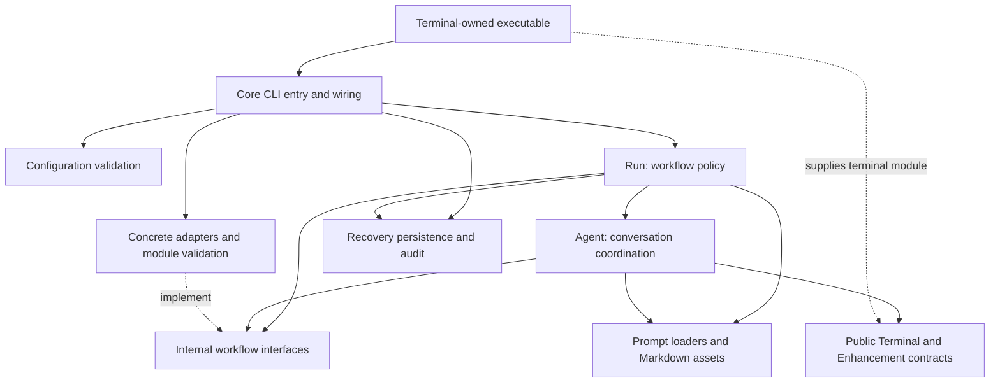

# Code architecture

Use this map to place Core changes and their tests. Interface behavior belongs in the [public integration contract](terminal-contract.md); build and check commands belong in the [README](../README.md#developing-core).

## Directory map

```text
src/
|-- cli-entry.ts           # Public runCli/CliOptions; process, operator, signals.
|-- cli.ts                 # Internal argument parsing and concrete dependency wiring.
|-- terminal.ts            # Public v2 terminal/enhancement interfaces; no transport.
|-- config.ts              # Startup validation, Project lookup, init templates.
|-- config-terminal.ts     # Core-owned generic terminal settings and defaults.
|-- run/                   # Delivery policy and observed acceptance of external facts.
|   |-- run.ts             # Run scope, restoration, selection and dispatch.
|   |-- parent.ts          # Parent rescan, completion and closure policy.
|   |-- discovery.ts       # Eligibility, Reservations, saved Batch membership.
|   |-- batch.ts           # Concurrent execution, integration barrier, doc trigger.
|   |-- standalone.ts      # Issue implementation and local completion verification.
|   |-- review.ts          # Review/fix rounds, commits, findings-file cleanup.
|   |-- verification.ts    # Independent Worktree/base/branch/commit checks.
|   |-- publication.ts     # Push/PR intent, checks and CI repair.
|   |-- integration.ts     # Merge/closure confirmation; doc no-change closure.
|   |-- documentation.ts   # Maintenance occurrences and their recovery scope.
|   |-- execution-recovery.ts # Saved execution validation and explicit Issue restart.
|   |-- repair.ts          # CI/conflict repair execution and retained progress.
|   |-- operations.ts      # Bounded operations, retries, cancellation and Pause.
|   |-- cleanup.ts         # Owned tabs, successful Worktree/branch/handoff cleanup.
|   |-- report.ts          # Ordered Issue outcomes, PRs and retained resources.
|   `-- contracts.ts       # Tracker/CodeHost/GitWorkspace/Clock/OperatorIO boundaries.
|-- agent/
|   |-- conversation.ts    # Per-tab startup phases, Assignments, queue, revocation.
|   |-- stage.ts           # Probe, native resume, handoff polling/correction, lifecycle.
|   `-- handoff.ts         # Handoff and native-identity validation.
|-- adapters/              # Concrete API/Git/clock/operator I/O and module validation.
|   |-- enhancement-discovery.ts # Verify terminal install; load same-prefix modules.
|   `-- terminal-plugin.ts # Validate supplied terminal module/factory result.
|-- recovery.ts            # Input hash and atomic Recovery Snapshots.
|-- audit.ts               # Workflow event records.
`-- prompts/               # Load built-in Markdown and substitute runtime values.
prompts/                   # Complete built-in stage, Probe and handoff messages.
templates/                 # User-editable config comments and three Project prompts.
skills/issue-runner-handoff/ # Atomic result protocol; task instructions stay in prompts.
tests/
|-- agent/                 # Handoff parsing without application setup.
|-- run/                   # Application scenarios, concurrency and recovery.
|-- adapters/              # External boundaries and real local Git repositories.
|-- support/               # Shared fixtures and private dependency substitutes.
|-- fixtures/              # Public consumer and installation fixtures.
|-- package/               # Installed artifact/public consumer verification helpers.
|-- package.test.mjs       # Real pack/install in isolated consumer/global prefixes.
`-- release/               # Release automation boundaries using command substitutes.
scripts/release/           # Release PR/candidate/publication tooling, outside runtime.
```

## Dependency direction

CLI composes concrete dependencies. Run decides delivery policy; Agent coordinates conversations through public terminal capabilities.



Only entry wiring imports concrete adapters. `run/` and `agent/` depend on contracts, not concrete transports or Agent SDKs. Terminal packages implement I/O; native Herdr transport belongs in its plugin repository.

## Module ownership

Keep policy with its workflow owner and external operations with adapters:

| Concern | Owner | Boundary |
| --- | --- | --- |
| Process and CLI | `cli-entry.ts`, `cli.ts` | Command identity, signals/operator, validation and lazy dependency assembly; no Core executable |
| Configuration | `config.ts`, `config-terminal.ts` | Project/init, credential/prompt validation, generic defaults; adapter-owned options remain opaque |
| Delivery workflow | `run/run.ts`, `discovery.ts`, `batch.ts`, `standalone.ts` | Scope, Reservations, eligibility, Batch membership, concurrency and acceptance barriers |
| Review, publication, integration | `run/review.ts`, `publication.ts`, `integration.ts`, `repair.ts` | Verify local/remote facts before crediting delivery; own remote mutations and repair budgets |
| Documentation | `run/documentation.ts` | Maintenance Ticket occurrences, Batch associations, continuation and cleanup scope; reuse standalone execution without business selection or ordinary Review |
| Session coordination | `agent/conversation.ts`, `stage.ts` | Per-tab startup, readiness retry, exact native identity, Probe/handoff corrections, Assignment/recovery queue and capability revocation |
| Public interfaces | `terminal.ts`, `cli-entry.ts` | Supported plugin/CLI contracts; keep implementation and testing entries private |
| External operations | `adapters/`, `run/contracts.ts` | API/Git/clock/operator operations and facts; no workflow decisions in adapters |
| Enhancement discovery | `adapters/enhancement-discovery.ts`, CLI | Validate executing terminal installation; resolve optional same-prefix modules; never initialize instances |
| Recovery persistence | `recovery.ts` | Atomic snapshots and shared hash of canonical command name, exact args, validated config bytes; versions and installation paths excluded |
| Restored behavior | `run/`, `agent/`, `run/execution-recovery.ts` | Revalidate saved ownership/context, resume exact native refs, preserve unfinished resources, explicitly restart unrecoverable Issues |
| Audit | `audit.ts`, operation owners | Record workflow facts; retry failed logging without replaying completed external operations |
| Cleanup and reporting | `run/cleanup.ts`, `review.ts`, `report.ts`, `agent/conversation.ts` | Checkpoint owned-resource removal; findings belong to Review; enhancement cleanup precedes owned-tab closure; retain/report failed and unfinished resources |

## Code placement rules

Preserve these boundaries when extending existing modules:

- Keep business logic in `run/` and `agent/` OS- and coding-agent-agnostic. Put platform details in adapters/plugins and Agent-specific start/resume commands in configuration.
- Let adapters return facts and perform operations. Run owns acceptance, remote mutations, integration order, and tracker closure policy.
- CLI discovers enhancement modules; `agent/conversation.ts` creates one instance per Runner Tab with unchanged bound I/O. Core retains Assignment IDs, expected files, and recovery wording. Queue Assignment changes and accepted recovery through actual adapter submission.
- `agent/stage.ts` owns shared startup/Probe, readiness rejection Pause, exact resume validation, and handoff correction for every purpose. Retry retains completed startup phases. Cancellation/failure revokes automatic I/O before cleanup; late factories transfer instances only for cleanup.
- Keep cleanup failure separate from operational failure. Failed enhancement cleanup retains the interactive tab and can retry; successful cleanup is idempotent. Apply the [lifecycle contract](terminal-contract.md#lifecycle-and-failure-flows).
- Keep helper functions in their owning module. Extract shared code for actual callers, while preserving validation and error handling.
- Keep complete Agent messages in built-in Markdown assets, including headings, context labels, Project-instruction placement, and handoff instructions. Code loads templates and substitutes values once; it does not append prompt text.
- Preserve separate roles for repository Agent instructions, executable prompts, user-editable templates, and the handoff protocol. Configuration-field guidance belongs in `templates/config.yaml` comments.
- Restore pending Batch documentation barriers before discovery. Persist each Batch's maintenance association before starting documentation; successful verified no-change documentation also satisfies the barrier.
- Validate ownership before successful-resource cleanup and checkpoint completed deletions. Retain unfinished work, failed repair attempts, and unmerged PR resources. CLI renders reports preserved by Run on failure/cancellation.

## Test placement rules

Test observable behavior at the owning boundary, using the existing suites:

| Location | Verify | Does not establish |
| --- | --- | --- |
| `tests/agent/` | Public handoff/result parsing and native-reference validation | Terminal delivery or workflow orchestration |
| `tests/run/` | Complete application scenarios, startup, Assignments, enhancements, publication, maintenance, cancellation and matching-input recovery | Live GitHub/native Agent behavior |
| `tests/adapters/` | Scripted GitHub commands and real Git repositories, Worktrees, environment/path handling | Production credentials or native terminal transport |
| `tests/package.test.mjs`, `tests/package/`, `tests/fixtures/` | Built or supplied candidate installation, exported types, inert imports, terminal-owned launcher, bundled templates/prompts/skill, enhancement discovery layouts | Registry publication or native Herdr/Agent acceptance |
| `tests/release/` | Candidate identity and release workflow command boundaries | A genuine npm/OIDC upload; command substitutes skip Windows |
| Root architecture checks | Dependency/import rules and module size limits | Correct behavior by themselves |

Use `tests/support/` for private fakes and shared application fixtures. Keep temporary projects and repositories owned by their tests. Exercise pure validation without application setup; exercise workflow outcomes through the existing dependency boundary. Add no public testing export. The existing Ubuntu/Windows matrix and real npm acceptance records cover different boundaries; neither substitutes for the other.
