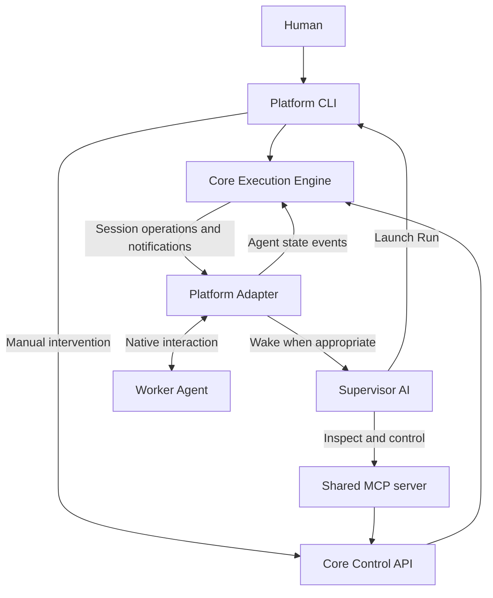
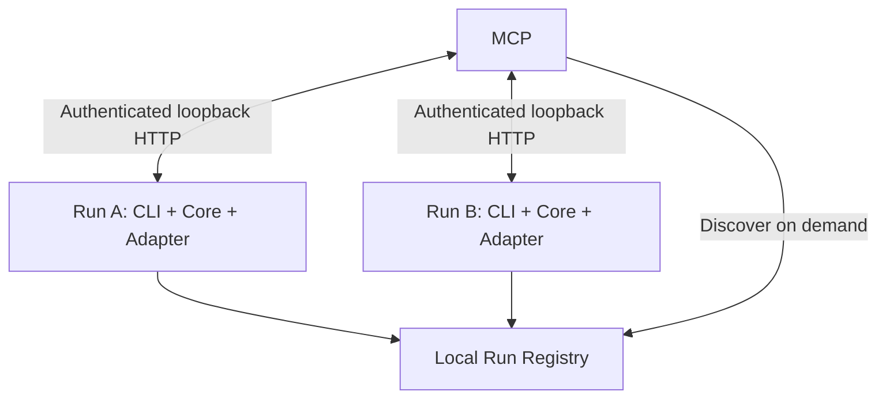
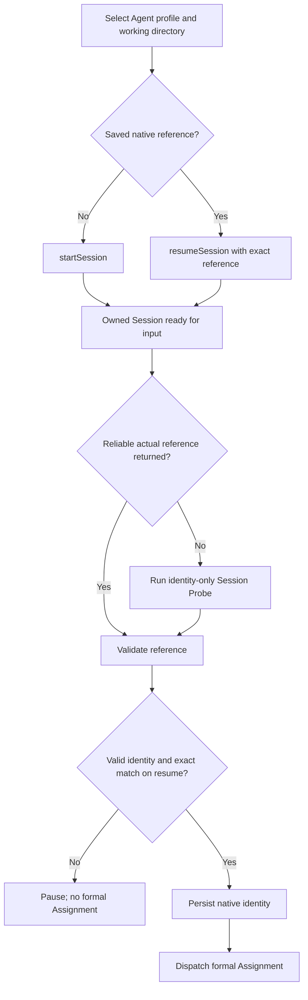
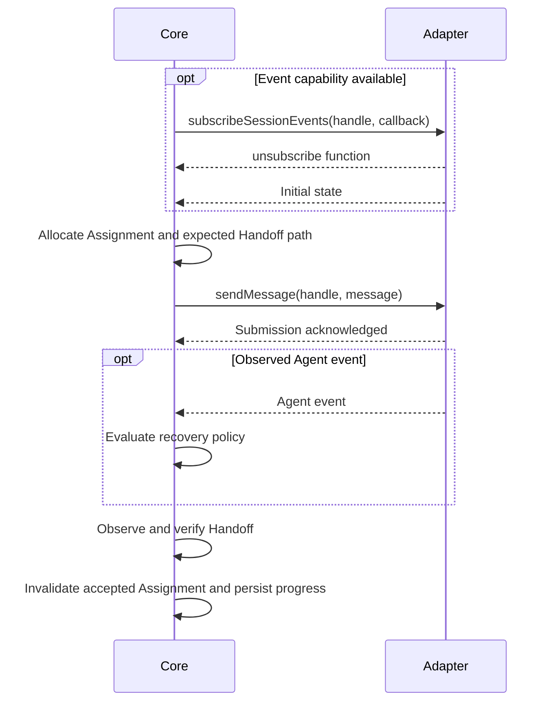
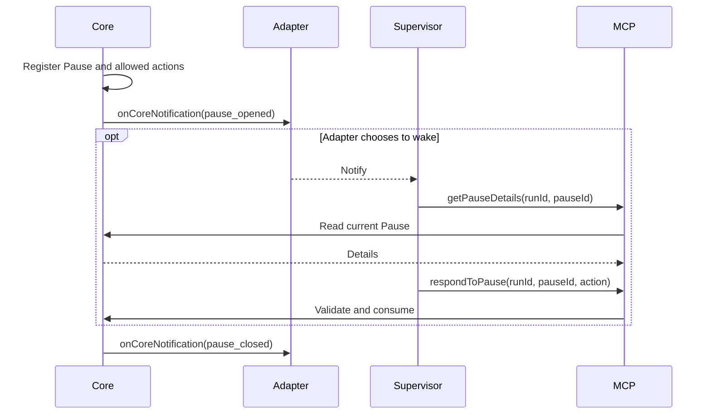
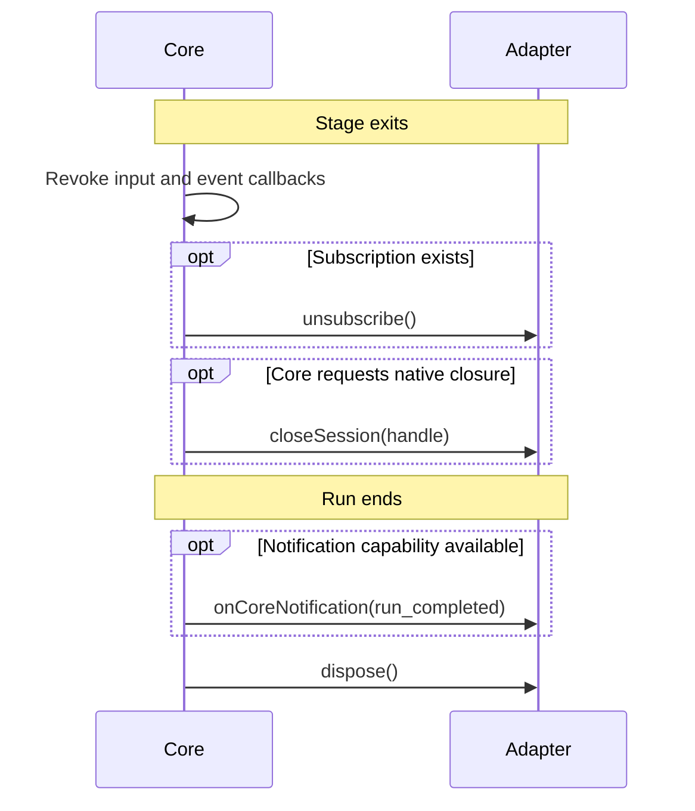

# Public integration contract

> Draft for human review. The architecture and decisions Q1–Q15 are agreed; the concrete types and behavior below are proposed for review. This is not the current runtime contract, and this revision is not binding until approved.

## Responsibilities and public entries



| Public entry | Consumer | Responsibility |
| --- | --- | --- |
| `issue-runner-core/cli` | Platform CLI | Run launch, manual interaction, MCP routing |
| `issue-runner-core/adapter` | Platform Adapter | Version, interfaces, and shared data types |
| `issue-runner-core/mcp` | CLI | Provider-independent MCP server |

Platform packages depend on Core and own their executables. Core registers no executable. The internal Core Control API is shared by CLI and MCP, not a separate public SDK.

## Shared identities and data

| Term | Meaning |
| --- | --- |
| Run | One live CLI workflow invocation, potentially containing multiple Issues |
| Issue execution | One occurrence of an Issue in a Run, identified by its existing execution ID |
| Stage | Implementation, Review, repair, or documentation work within an Issue execution |
| Assignment | A Core-owned request associated with an expected Handoff |
| Agent Session | An owned live unit for executing Agent work |
| Native Session Reference | Persistable identity of the actual native conversation |
| Session Handle | Opaque, instance-owned live operation target, never persisted |

```typescript
export type RunId = string;
export type ExecutionId = string;
export type AssignmentId = string;
export type MessageId = string;
export type PauseId = string;
export type NativeSessionReference = string;
export type SessionHandle = object;

export type Stage =
  | "implement" | "review" | "fix_review"
  | "ci_repair" | "conflict_repair" | "documentation";

export type RunSelection =
  | { kind: "parent"; issueNumber: number }
  | { kind: "issue"; issueNumber?: number }
  | { kind: "document" };
```

```typescript
export interface RunIdentity {
  runId: RunId;
  project: string;
  repository: string;
  selection: RunSelection;
  targetBranch: string;
  autoMerge: boolean;
  startedAt: string;
}

export interface IssueContext {
  issueNumber: number;
  executionId?: ExecutionId;
  stage?: Stage;
  assignmentId?: AssignmentId;
  worktree?: string;
  nativeSessionReference?: NativeSessionReference;
}

export type WorkScope =
  | { kind: "run" }
  | { kind: "issue"; issue: IssueContext };
```

- IDs are nonempty strings; Issue numbers are positive safe integers. Times are ISO 8601 UTC strings.
- The live Run ID is unique for each CLI invocation, including a restart from a checkpoint. Historic checkpoint IDs are not live control targets.
- An Issue context omits facts not yet available. A bare Issue number is not an execution or Assignment identity.
- Public snapshots and notifications contain JSON-compatible values; omitted fields mean unknown or not applicable. No handles, credentials, AbortSignals, commands containing secrets, or raw Error objects in serialized data.

## CLI integration

```typescript
export interface CliOptions {
  commandName: string;
  commandVersion: string;
  adapter: PlatformAdapterModule;
}

export declare function runCli(options: CliOptions): Promise<void>;
```

```typescript
// Platform-owned executable.
import { runCli } from "issue-runner-core/cli";
import * as adapter from "./adapter.js";

await runCli({
  commandName: "issue-runner-platform",
  commandVersion: "1.0.0",
  adapter,
});
```

| Parameter | Definition |
| --- | --- |
| `commandName` | Installed platform CLI's name, used in help and diagnostics |
| `commandVersion` | Platform package version, not a recovery identity |
| `adapter` | Explicit module implementing the versioned Adapter contract |

| CLI command | Behavior |
| --- | --- |
| `init --project <key>` | Existing Project configuration and prompt initialization |
| `run --project <key> --parent <number>` | Existing parent workflow |
| `run --project <key> --issue [<number>]` | Existing standalone or configured Issue selection |
| `run --project <key> --document` | Existing documentation workflow |
| `--help`, `--version` | Existing behavior |
| `mcp` | Start the shared stdio MCP server |

- Preserve existing argument restrictions, configuration location, merge flags, manual confirmation behavior, cancellation signals, and exit codes.
- `runCli` reads process arguments and working directory; resolves when the command exits, sets exitCode, and removes listeners. It does not call process.exit.
- Validate Run inputs before workflow effects. Help, version, init, and mcp do not instantiate an Adapter.
- The platform CLI forwards mcp without platform environment checks, Project loading, or platform authorization preflight. Adapter module import must not create resources.
- A Run executes in the launching CLI process. No central workflow daemon or automatic Adapter discovery.

## Platform Adapter interfaces

### Module and initialization

```typescript
export declare const adapterContractVersion: 1;

export type PlatformAdapterConfig = Readonly<Record<string, unknown>>;

export interface PlatformAdapterModule {
  readonly contractVersion: typeof adapterContractVersion;
  createPlatformAdapter(
    config: PlatformAdapterConfig,
  ): Promise<PlatformAdapter>;
}
```

- Core passes the `platformAdapter` mapping (default empty object).
- The factory validates its settings and native context before returning. It owns untransferred resources and cleans them on failure.
- Core validates the version before invoking the factory and required/optional method shapes before workflow effects. Missing optional methods are valid; malformed implementations are not.
- One instance per Run; dispose a successfully transferred instance even if initialization completes after cancellation.

### Session operations

```typescript
export interface SessionOptions {
  agent: string;
  command: string;
  cwd: string;
  label: string;
  signal: AbortSignal;
}

export interface ResumeSessionOptions extends SessionOptions {
  nativeSessionReference: NativeSessionReference;
}

export interface OpenedSession {
  handle: SessionHandle;
  nativeSessionReference?: NativeSessionReference;
}

export interface AgentMessage {
  messageId: MessageId;
  assignmentId: AssignmentId;
  text: string;
}
```

| Parameter | Definition |
| --- | --- |
| `agent` | Configured Agent identifier; opaque to Core except validation and checkpoint comparison |
| `command` | Full configured start command or expanded resume command |
| `cwd` | Absolute, existing stage working directory |
| `label` | Human-readable Session label; never a routing identity |
| `signal` | Combined Run cancellation and Session revocation signal |
| `nativeSessionReference` (resume input) | Exact persisted reference to restore |
| `handle` (result) | Unique live operation target owned by this Adapter instance |
| `nativeSessionReference` (result) | Actual known persistent native identity; omit if unavailable or unreliable |
| `messageId` | Core-generated unique ID for this submission |
| `assignmentId` | Current Core Assignment, including identity-only Probe requests |
| `text` | Complete prompt or recovery message |

```typescript
export interface PlatformAdapter {
  startSession(options: SessionOptions): Promise<OpenedSession>;
  resumeSession(options: ResumeSessionOptions): Promise<OpenedSession>;
  sendMessage(handle: SessionHandle, message: AgentMessage): Promise<void>;
  closeSession(handle: SessionHandle): Promise<void>;
  dispose(): Promise<void>;

  subscribeSessionEvents?(
    handle: SessionHandle,
    onEvent: (event: AgentEvent) => void,
  ): Promise<() => Promise<void>>;

  onCoreNotification?(notification: CoreNotification): void | Promise<void>;
}
```

| Method | Successful return |
| --- | --- |
| `startSession` | New owned Session ready to receive input |
| `resumeSession` | Owned Session ready for input after attempting exact native resume |
| `sendMessage` | Complete message submission acknowledged, not task completion |
| `closeSession` | Exact owned native representation closed or already absent |
| `dispose` | Run-level Adapter resources released |
| `subscribeSessionEvents` | Subscription established; returns async unsubscribe |
| `onCoreNotification` | Notification handled or deliberately ignored, not workflow authorization |

- Reject invalid or foreign handles and unsupported working directories. Do not redirect a Session to another target.
- Core serializes input per Session; separate Sessions operate concurrently. Preserve text except existing line-ending normalization.
- Check the bound signal before automatic operations. Revocation prevents new input, not rollback of already-started input. Keep the input queue until the underlying submission settles.
- Explicit closure and subscription cleanup remain possible on the same owned target after revocation.
- `dispose` must not close retained Agent Sessions, erase native history, or affect the Supervisor. It may be a no-op for resource-free Adapters.

### Failure contract

```typescript
export interface AdapterOperationError extends Error {
  effect: "none" | "applied" | "unknown";
  code: string;
  handle?: SessionHandle;
}

export interface SessionReadinessError extends AdapterOperationError {
  effect: "applied";
  handle: SessionHandle;
  retryReadiness(): Promise<OpenedSession>;
}
```

- `none` means the Adapter knows the requested operation had no effect; `applied` means its effect is known; `unknown` means the effect cannot be established.
- If launch succeeded but readiness failed, a recoverable readiness error may provide the exact owned handle and a retry of readiness only. It must not start a second Session.
- Core reports malformed or uncertain outcomes, pauses rather than blindly replaying a launch or message, and retains identifiable resources for manual inspection.
- A timeout or exception alone is not evidence of no effect. Cleanup errors are reported separately from workflow errors.
- Treat an unstructured Adapter error as an unknown effect, not as permission to retry.

## Optional capabilities

| Capability | When absent |
| --- | --- |
| Session event subscription | No Agent-state-driven automatic recovery; Handoff observation and manual control continue |
| Core notification receiver | No Adapter-driven Supervisor wake-up; manual CLI and MCP control continue |

Both capabilities are independent.

### Agent state events

```typescript
export type AgentState =
  | "idle" | "running" | "waiting_for_input" | "unknown";

export interface AgentEventBase {
  sequence: number;
  timestamp: string;
  messageId?: MessageId;
  nativeTurnId?: string;
}

export type AgentEvent = AgentEventBase & (
  | { type: "state"; state: AgentState; detail?: string }
  | { type: "turn_ended"; outcome: "completed" | "failed" | "cancelled";
      error?: ErrorDetail }
  | { type: "session_closed"; error?: ErrorDetail }
  | { type: "observation_lost"; error: ErrorDetail }
  | { type: "observation_restored"; state: AgentState }
);
```

| Field | Definition |
| --- | --- |
| `sequence` | Positive increasing sequence within one subscription, including initial state |
| `timestamp` | Time the event was observed |
| `messageId` | Exact associated Core message if Adapter can establish the correlation |
| `nativeTurnId` | Native turn identity when available; not an Assignment ID |
| `state` | Currently observed agent state, not a Handoff result |
| `outcome` | Observed terminal result of a specific Agent turn |
| `error` / `detail` | Sanitized diagnostic facts, when available |

| Event | Meaning |
| --- | --- |
| `state` | Initial or changed Agent state |
| `turn_ended` | Actual observed turn ended; only emit when known |
| `session_closed` | Native Session ended or ceased to exist |
| `observation_lost` | Events or state can no longer be observed reliably |
| `observation_restored` | Observation resumed and a current state was reconciled |

- The callback is bound to the specified Session Handle; no separate handle in the payload.
- Install observation before dispatching a message. Deliver initial state and subsequent facts without a gap; reconcile after lost observation.
- Do not fabricate turn or message correlation from arrival order. Uncorrelated events cannot establish that a particular Assignment completed or authorize message replay.
- Adapter normalizes native ordering and duplicates where possible. Core rejects stale callbacks and duplicate or regressive sequence values.
- Unsubscribe on every Stage exit, even when retaining the native Session. The returned function releases only its subscription; repeated calls are safe. Invalidate callbacks before cleanup.
- No Agent-state polling fallback. Existing Handoff and deterministic GitHub observation remain unchanged.

### Core notifications

```typescript
export interface ErrorDetail {
  code: string;
  message: string;
}

export type PauseAction =
  | "continue" | "retry" | "restart" | "skip" | "cancel";

export interface PauseSummary {
  pauseId: PauseId;
  scope: WorkScope;
  state: "active" | "queued";
  message: string;
  allowedActions: readonly PauseAction[];
}

export interface PauseDetails extends PauseSummary {
  openedAt: string;
  operation: string;
  reason: ErrorDetail;
  pullRequest?: PullRequestRef;
  handoffPath?: string;
  logPath?: string;
}
```

| Pause field | Definition |
| --- | --- |
| `scope` | Run-wide or affected Issue execution; not the CLI queue position |
| `state` | Active confirmation or waiting in the confirmation queue |
| `message` | Human-readable intervention prompt |
| `allowedActions` | Core-authorized actions at the time of the snapshot |
| `operation` | Core operation requiring intervention, e.g. required checks or Session readiness |
| `reason` | Structured error code and non-secret explanation |
| `pullRequest`, `handoffPath`, `logPath` | Diagnostic references when applicable |

```typescript
export type ProgressEvent =
  | "run_started" | "batch_started" | "batch_completed"
  | "issue_started" | "issue_completed"
  | "stage_started" | "stage_completed"
  | "pr_published" | "ci_wait_started" | "ci_wait_completed"
  | "merge_requested" | "merge_completed"
  | "cleanup_completed";

export interface NotificationBase {
  runId: RunId;
  project: string;
  repository: string;
  timestamp: string;
  sequence: number;
  message: string;
}
```

```typescript
export type CoreNotification = NotificationBase & (
  | {
      type: "progress";
      event: ProgressEvent;
      scope: WorkScope;
      pullRequest?: PullRequestRef;
    }
  | { type: "pause_opened"; pause: PauseDetails }
  | { type: "pause_activated"; pause: PauseDetails }
  | {
      type: "pause_closed";
      pauseId: PauseId;
      scope: WorkScope;
      resolution: "responded" | "invalidated" | "cancelled";
      action?: PauseAction;
    }
  | { type: "run_completed"; summary: RunSummary }
);
```

| Notification | Trigger |
| --- | --- |
| `progress` | Meaningful Core workflow transition, after the transition is committed |
| `pause_opened` | A new Pause is registered, including its current queue state |
| `pause_activated` | A queued Pause becomes the active confirmation |
| `pause_closed` | The Pause is consumed, invalidated, or cancelled; action present only on response |
| `run_completed` | Final reportable Run outcome after workflow settlement |

Common fields identify the Run and order its notifications; `message` is a display description, not a control instruction. The Pause ID and shared `PauseDetails` let a Supervisor query the current Pause through MCP before acting.

- Adapter decides whether to display, ignore, or wake the Supervisor for each notification.
- Core does not wait for a Supervisor response inside the notification callback. Failure to deliver a notification does not authorize recovery, resolve a Pause, or block the workflow.
- Core delivers notifications in sequence order without waiting for asynchronous completion of earlier deliveries. A rejection becomes a diagnostic; no workflow replay.
- Dispatch a final notification before Adapter disposal when a reportable outcome and initialized Adapter exist. Dispose releases pending delivery resources; delivery is not guaranteed after process termination.
- CLI continues to display actionable errors, Pause prompts, and control results; log recording is independent. Proposed output policy: ordinary progress and final Run reporting use structured notifications rather than Core terminal progress output.

## Configuration

```typescript
export interface AgentConfig {
  agent: string;
  start: string;
  resume: string;
}

export type AgentProfiles = {
  implement: AgentConfig;
  ciRepair: AgentConfig;
  conflictRepair: AgentConfig;
  review?: AgentConfig;
  documentation?: AgentConfig;
};
```

```yaml
agents:
  implement:
    agent: codex
    start: 'codex --model gpt-5.4 -c model_reasoning_effort=high'
    resume: 'codex resume "{sessionref}"'

platformAdapter: {}
```

- Preserve existing role requirements and the rest of Project configuration.
- Validate nonempty `agent`, `start`, `resume` and the required `{sessionref}` placeholder. Pass start unchanged; substitute every placeholder literally on resume.
- Users supply Provider-specific launch options. Core does not parse model, effort, permission, or other Provider arguments. Adapters understand their platform format, not per-Provider parameter translation.
- Remove terminalPlugins, enhancements, agentStartDelay, submitKey, unused per-Agent options, and Core environment overlays. Adapter settings remain opaque to Core.

## Core Control API and MCP

### State and result types

```typescript
export interface PullRequestRef {
  number: number;
  url: string;
  title?: string;
}

export type RunOutcome =
  | "succeeded" | "no_work" | "incomplete" | "cancelled" | "failed";

export type IssueOutcome =
  | "completed" | "pr_ready" | "no_change" | "no_work"
  | "incomplete" | "cancelled" | "failed";

export interface IssueResult {
  issue: IssueContext;
  kind: "delivery" | "maintenance";
  outcome: IssueOutcome;
  pullRequest?: PullRequestRef;
  detail: string;
  retainedWorktrees: readonly string[];
}
```

```typescript
export interface RetainedEvidence {
  issueNumber?: number;
  executionId?: ExecutionId;
  recordedBranches: readonly string[];
  worktrees: readonly string[];
  paths: readonly string[];
}

export interface RunSummary {
  run: RunIdentity;
  outcome: RunOutcome;
  finishedAt: string;
  issues: readonly IssueResult[];
  failure?: ErrorDetail;
  retainedEvidence: readonly RetainedEvidence[];
  logPath?: string;
}
```

```typescript
export type IssuePhase =
  | "reserved" | "worktree_created" | "probing"
  | "implementing" | "implementation_completed"
  | "documenting" | "documentation_completed"
  | "reviewing" | "review_completed"
  | "fixing_review" | "fix_review_completed"
  | "repairing_ci" | "ci_repair_completed"
  | "repairing_conflict" | "conflict_repair_completed"
  | "publication_eligible";

export type PublicationPhase =
  | "pending_push" | "pushed" | "pending_pr" | "pr_created"
  | "checks_ready" | "checks_failed" | "conflict_repair"
  | "pending_merge" | "merge_requested" | "merged" | "delivered";
```

```typescript
export interface IssueStatus {
  issue: IssueContext;
  kind: "delivery" | "maintenance";
  phase?: IssuePhase;
  publicationPhase?: PublicationPhase;
  pullRequest?: PullRequestRef;
  handoffPath?: string;
  lastError?: ErrorDetail;
  result?: IssueResult;
}

export interface RunStatus {
  run: RunIdentity;
  state: "running" | "paused" | "cancelling" | "completed";
  issues: readonly IssueStatus[];
  pauses: readonly PauseSummary[];
  logPath?: string;
  summary?: RunSummary;
}
```

- State exposes Core's current known facts, not reconstructed provider conversation history. Issue and publication phases reflect existing workflow state.
- `paused` means a Run-wide intervention stops Run progression; a local Issue Pause is represented in pauses without changing the entire Run to paused. State and Pause arrays are snapshots, not mutable references.
- `summary` is present only when a final outcome is available. Local registry discovery lists live Runs, not historical results.
- Output types represent the current workflow's results; they do not change checkpoint serialization or workflow acceptance rules.

### Per-Run control

```typescript
export type ControlErrorCode =
  | "run_not_found" | "run_unavailable"
  | "pause_not_found" | "pause_not_active"
  | "action_not_allowed" | "run_ending"
  | "invalid_request" | "unauthorized" | "incompatible_version";

export type ControlResult<T> =
  | { ok: true; value: T }
  | { ok: false; error: ErrorDetail & { code: ControlErrorCode } };

interface RunControl {
  readonly runId: RunId;
  getStatus(): Promise<RunStatus>;
  listPauses(): Promise<readonly PauseSummary[]>;
  getPauseDetails(pauseId: PauseId): Promise<ControlResult<PauseDetails>>;
  respondToPause(
    pauseId: PauseId, action: PauseAction,
  ): Promise<ControlResult<null>>;
  cancel(): Promise<ControlResult<null>>;
}
```

| Method | Contract |
| --- | --- |
| `getStatus` | Current read-only Run snapshot |
| `listPauses` | Unresolved active and queued Pauses |
| `getPauseDetails` | Find the identified live Pause and its current allowed actions |
| `respondToPause` | Validate and consume one active Pause response |
| `cancel` | Request orderly Run cancellation; success is acknowledgement, not completion |

- Manual CLI input and MCP use the same actions. Core validates the identity, active state, allowed actions, and lifecycle atomically. The first valid response consumes the Pause; stale, duplicate and invalid responses cannot mutate the workflow.
- Proposed FIFO behavior: queued Pauses can be inspected but cannot be answered until active. A Scope can be paused independently of the terminal confirmation queue.
- Action meanings: continue acknowledges an intervention; retry repeats an eligible operation; restart explicitly restarts the affected workflow; skip applies only when allowed; cancel requests Run cancellation. Existing CLI key mappings remain.
- No external arbitrary mutation, proactive pause command, direct Worker Agent input, or native conversation history reader.

### MCP startup and tools

```typescript
// issue-runner-core/mcp
export declare function runMcp(): Promise<void>;
```

```json
{
  "mcpServers": {
    "issue-runner": {
      "command": "issue-runner-platform",
      "args": ["mcp"]
    }
  }
}
```

```typescript
export interface LiveRun {
  run: RunIdentity;
  state: RunStatus["state"];
}

export interface McpTools {
  listRuns(): Promise<ControlResult<readonly LiveRun[]>>;
  getRunStatus(input: { runId: RunId }): Promise<ControlResult<RunStatus>>;
  listPauses(input: { runId: RunId }): Promise<ControlResult<readonly PauseSummary[]>>;
  getPauseDetails(input: {
    runId: RunId; pauseId: PauseId;
  }): Promise<ControlResult<PauseDetails>>;
  respondToPause(input: {
    runId: RunId; pauseId: PauseId; action: PauseAction;
  }): Promise<ControlResult<null>>;
  cancelRun(input: { runId: RunId }): Promise<ControlResult<null>>;
}
```

`McpTools` describes the tool input and structured result schemas, not a public TypeScript client. MCP exposes the same tool names and arguments regardless of platform CLI.

- The AI client starts the platform CLI's mcp subcommand over stdio. No Adapter initialization or Run launch.
- Stdout carries MCP protocol traffic; diagnostics use stderr. A disconnected MCP client does not stop any Run.
- Every external operation except discovery requires a Run ID. The MCP server forwards it to the exact live Core instance; it validates the live identity before applying a mutation.

### Local Run discovery



- Each Run publishes a record under `~/.issue-runner/active-runs/` after its local control endpoint is ready. The record identifies its Run and connection information; it is not a workflow state store.
- Each endpoint listens only on loopback using an available port and requires authorization. Protect local connection credentials with OS-user access controls; never return them from MCP tools.
- Discovery checks live Run identity on demand. Reject stale, incompatible, or unauthorized records; port or process reuse cannot select another Run.
- Unregister on orderly exit. No daemon, continuous status polling, cross-machine discovery, or separate Core installation.
- The registry format and private HTTP wire protocol require a separate detailed design; the public tool schemas above do not depend on their encoding.

## Lifecycle and failure flows

### Startup and exact resume



- Adapter establishes readiness; no fixed Core startup delay.
- Core uses the existing identity-only Probe and correction flow only when a trustworthy reference is unavailable. Probe evidence is Agent-reported and does not replace stronger native evidence where available.
- Reject empty references, latest/last selectors, Run or execution IDs, and platform routing IDs masquerading as native conversation identities. A requested resume ID is not proof of the actual restored identity.
- Keep checkpoint identity fields `sessionid`, `agent`, and expanded `resume`. Validate the current profile and exact actual reference; persist identity before formal work.
- A known Session that fails readiness may be rechecked through its provided readiness continuation; never relaunch after an uncertain result.
- If the expected conversation cannot be verified, pause and preserve the evidence. Never silently substitute another conversation.

### Assignment and Handoff



- Core owns prompt content, Assignments, Handoff verification, and recovery policy. Native Agent state does not establish task completion.
- Recovery and correction messages use fresh message IDs, the applicable Assignment ID, and the same owned Session. Stale events cannot authorize recovery for a replaced or accepted Assignment.
- Remove the old Enhancement recovery and pause callbacks. Adapter reports facts; Core determines whether to retry or require intervention.

### Pause and notification



The CLI can respond through the same control operation at any time the Pause is active. Neither notification delivery nor a stale notification determines the current Pause state.

### Stage exit and Run disposal



- Revoke automatic capabilities on every Stage exit and cancel late-transferred subscriptions immediately. A cleanup failure cannot reactivate a callback.
- Preserve accepted Handoff and checkpoint progress before cleanup. Retry cleanup only on the same owned target; retain and report incomplete resources.
- Dispose once on every orderly Run exit after final notification dispatch and Session cleanup attempts. Do not close retained Sessions or delete native history.

## Review boundary and remaining decisions

The concrete proposed type definitions, particularly AgentMessage correlation, AgentEvent, Adapter errors, CoreNotification, PauseDetails, RunStatus, RunSummary, and MCP results, require human review. The current decision remains open.

| Subsequent decision | Refines after contract approval |
| --- | --- |
| [Agent Lifecycle and Event Model](https://github.com/BuddyLabsCo/issue-runner-core/issues/474) | Event classification, correlation and ordering, observation loss |
| [Core-Owned Agent Recovery Policy](https://github.com/BuddyLabsCo/issue-runner-core/issues/475) | Recovery triggers, limits and Handoff handling |
| [Structured Run Control and Pause Management](https://github.com/BuddyLabsCo/issue-runner-core/issues/476) | Pause policies, valid actions and races |
| [Notification Contract and Terminal Output](https://github.com/BuddyLabsCo/issue-runner-core/issues/477) | Event inventory, payload semantics, output and delivery behavior |
| [Breaking Migration and Core Acceptance Criteria](https://github.com/BuddyLabsCo/issue-runner-core/issues/478) | Migration and acceptance |

Research: [Herdr Agent session capabilities](research/herdr-agent-session-capabilities.md).
