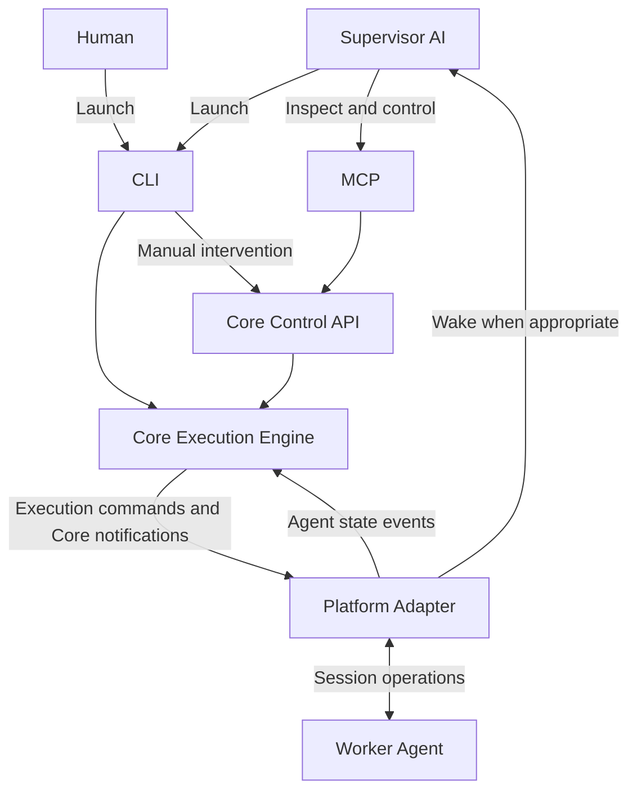
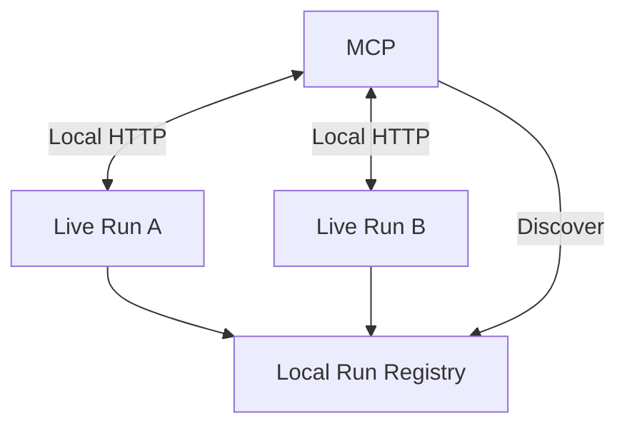
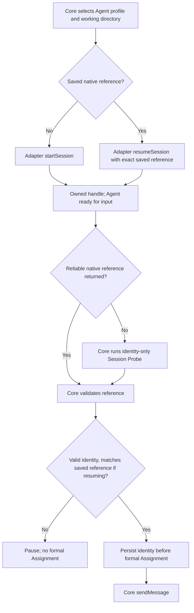
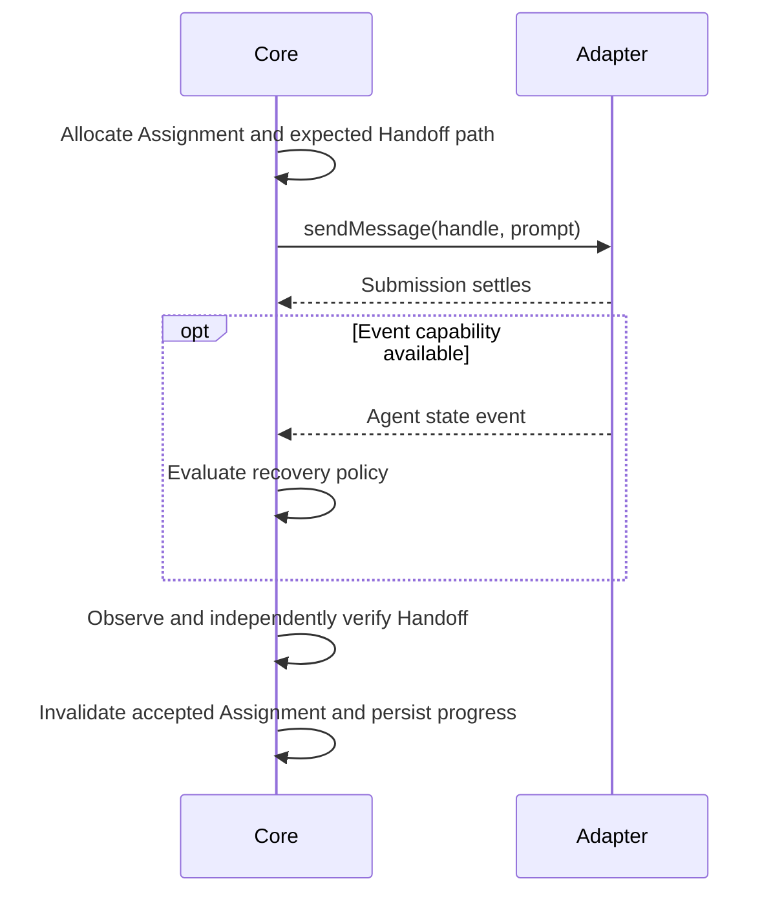
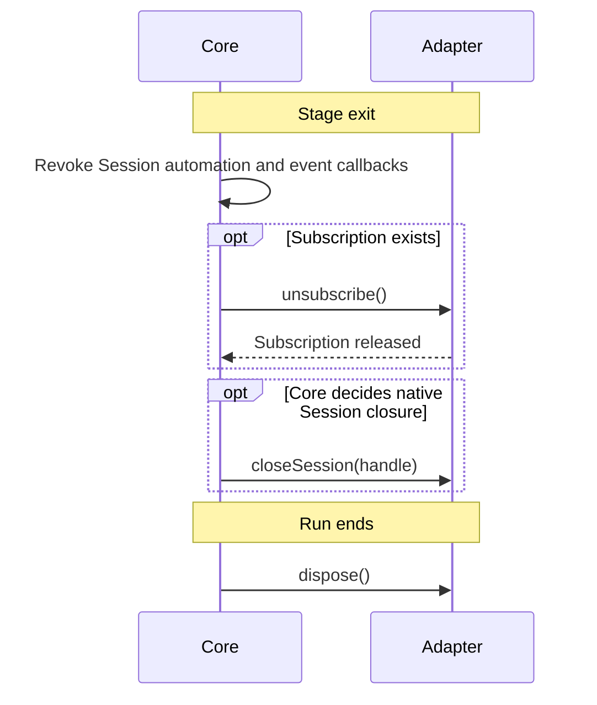

# Public integration contract

Design baseline for the unified Platform Adapter and Core Control API. This contract replaces the terminal and enhancement contracts upon implementation. It does not describe the current runtime.

## Responsibilities and public entries



| Public entry | Responsibility |
| --- | --- |
| `issue-runner-core/cli` | Run launch, operator interaction, and MCP command routing |
| `issue-runner-core/adapter` | Platform Adapter contract and types |
| `issue-runner-core/mcp` | Shared Model Context Protocol (MCP) access to existing Runs |

Core owns workflow, Handoff verification, recovery policy, checkpoints, and structured Run control. The CLI and MCP share the internal Core Control API; it is not a separate public SDK. Platform Adapters implement session operations, report Agent state events, and receive Core notifications. They do not implement a control API.

## CLI integration

```typescript
import type { PlatformAdapterModule } from "issue-runner-core/adapter";

export interface CliOptions {
  commandName: string;
  commandVersion: string;
  adapter: PlatformAdapterModule;
}

export function runCli(options: CliOptions): Promise<void>;
```

```typescript
// Platform-owned executable.
import { runCli } from "issue-runner-core/cli";
import * as adapter from "./adapter.js";

await runCli({
  commandName: "issue-runner-platform",
  commandVersion: "1.0.0",
  adapter,
});
```

- The CLI is the Run launch entry. Core executes in the launching CLI process and retains its platform context.
- Preserve existing `init`, `run`, `--help`, `--version`, Run arguments, manual intervention, and exit codes. Manual intervention invokes the Core Control API.
- Add the shared `mcp` subcommand. Help, version, init, and mcp do not instantiate an Adapter.
- Platform packages depend on Core and own their executables. Core is not installed separately and registers no executable.
- Core creates one Adapter per Run after validating the Run inputs. No automatic plugin or enhancement discovery, package installation path lookup, or legacy contract compatibility layer.
- No mandatory standalone service. Core owns the shared connection to an existing Run; MCP does not launch or reconstruct a Run.

## Platform Adapter interfaces

```typescript
export const adapterContractVersion = 1 as const;

export interface PlatformAdapterModule {
  readonly contractVersion: typeof adapterContractVersion;
  createPlatformAdapter(config: unknown): Promise<PlatformAdapter>;
}

// Opaque, instance-owned reference; never persisted.
export type SessionHandle = object;
export type NativeSessionReference = string;

export interface SessionOptions {
  agent: string;
  command: string;
  cwd: string;
  label: string;
  signal: AbortSignal;
}

export interface OpenedSession {
  handle: SessionHandle;
  nativeSessionReference?: NativeSessionReference;
}
```

```typescript
export interface PlatformAdapter {
  startSession(options: SessionOptions): Promise<OpenedSession>;
  resumeSession(
    options: SessionOptions & {
      nativeSessionReference: NativeSessionReference;
    },
  ): Promise<OpenedSession>;
  sendMessage(handle: SessionHandle, text: string): Promise<void>;
  closeSession(handle: SessionHandle): Promise<void>;
  dispose(): Promise<void>;

  subscribeSessionEvents?(
    handle: SessionHandle,
    onEvent: (event: AgentEvent) => void,
  ): Promise<() => Promise<void>>;
  onCoreNotification?(notification: CoreNotification): void | Promise<void>;
}
```

`AgentEvent` and `CoreNotification` denote structured payload types. Their fields and delivery semantics are refined in the lifecycle and notification decisions.

| Method | Contract |
| --- | --- |
| `createPlatformAdapter` | Validate platform settings and context. Transfer one valid instance to Core. |
| `startSession` | Launch an owned Agent Session in the requested working directory; resolve when ready for input. |
| `resumeSession` | Restore the exact requested native conversation in the requested working directory; resolve when ready for input. |
| `sendMessage` | Submit text to the owned Session; resolve on submission, not Agent completion. |
| `closeSession` | Close only the designated owned Session when Core requests closure. |
| `dispose` | Release Run-level Adapter resources; never close retained native conversations. |

Core validates the contract version and callable required methods before workflow effects. Missing optional methods are valid; invalid supplied methods are errors. The factory owns resources until the instance transfers to Core.

- Start and resume receive the configured command as opaque text. The Adapter interprets its platform's command format without requiring per-Provider parameter translation.
- `cwd` is an absolute working directory; reject unsupported context rather than redirecting the Session.
- Core owns the Session cancellation signal, combining Run cancellation with Session revocation. Check it before new automatic operations; cancellation does not undo completed effects or imply native Session closure.
- Core serializes message submissions per Session. Independent Sessions can run concurrently. A timeout must not release the submission queue before the underlying operation settles.
- Reject foreign handles and automatic input after revocation. Explicit cleanup may still target the same owned handle.
- Uncertain launch or message delivery requires intervention; do not automatically replay uncertain operations.
- No terminal screen, key-chord, or arbitrary native state read interface.

## Optional capabilities

| Capability | When absent |
| --- | --- |
| `subscribeSessionEvents` | Core continues Handoff observation and manual intervention; no Agent-state-driven recovery or polling fallback. |
| `onCoreNotification` | CLI output and MCP control remain available; no Adapter-driven Supervisor wake-up. |

The capabilities are independent. An Adapter may implement either, both, or neither.

### Agent state events

- Adapter reports facts about the designated Agent Session. Core decides recovery and workflow actions.
- Core subscribes before dispatching messages that need observation.
- The returned cancellation function releases that Session's subscription resources. Core invalidates callbacks before invoking it on Stage exit, including failure, skip, or cancellation.
- A subscription that settles after revocation is cancelled immediately. A cleanup error is reported; late events cannot trigger workflow actions.
- No continuous Agent-state polling as an alternative to subscriptions. Handoff file observation and deterministic GitHub checks are unchanged.

### Core notifications

- Core emits structured notifications to the Adapter.
- Adapter decides whether and how to notify or wake the Supervisor AI. Core neither requires nor identifies a Supervisor AI.
- Notification delivery does not resolve a Pause or authorize a workflow mutation. The Supervisor uses the shared MCP control entry.
- CLI output is independent of Adapter notifications. No terminal-output parsing is required by the public contract.

## Configuration

```yaml
agents:
  implement:
    agent: codex
    start: 'codex --model gpt-5.4 -c model_reasoning_effort=high'
    resume: 'codex resume "{sessionref}"'

platformAdapter: {}
```

- Preserve existing role selection and the three required fields: `agent`, `start`, `resume`.
- Core validates their shape and the required `{sessionref}` placeholder. It passes `start` unchanged and replaces every `{sessionref}` in `resume` literally.
- Users supply Provider-specific model, effort, and launch arguments in the commands. Core does not parse them; Adapters do not translate parameters for individual Providers.
- `platformAdapter` is an opaque configuration mapping passed to the factory. The Adapter owns its validation.
- Remove `terminalPlugins`, the independent `enhancements` mapping, Core `agentStartDelay`, `submitKey`, and unused per-Agent `options`. No Core-provided environment overlay.

## Core Control API and MCP

Each CLI invocation owns one live Run and its control interface.

```typescript
interface RunControl {
  readonly runId: string;
  getStatus(): Promise<RunStatus>;
  listPauses(): Promise<PauseSummary[]>;
  getPauseDetails(pauseId: string): Promise<PauseDetails>;
  respondToPause(pauseId: string, action: PauseAction): Promise<void>;
  cancel(): Promise<void>;
}
```

| MCP tool | Arguments |
| --- | --- |
| `listRuns` | None |
| `getRunStatus` | `runId` |
| `listPauses` | `runId` |
| `getPauseDetails` | `runId`, `pauseId` |
| `respondToPause` | `runId`, `pauseId`, `action` |
| `cancelRun` | `runId` |

- Queries return Core-owned workflow state, including Issue, Stage, Assignment, Pause, error, relevant PR, Native Session Reference, result, and log path as available.
- Core validates the allowed action and current target state. No proactive pause command, arbitrary state mutation, direct Worker Agent input, or native conversation history access.
- CLI and MCP use the same RunControl operations. Detailed response types and pause concurrency are defined in the control and pause decision.

### MCP startup

```typescript
// issue-runner-core/mcp
export function runMcp(): Promise<void>;
```

```json
{
  "mcpServers": {
    "issue-runner": {
      "command": "issue-runner-platform",
      "args": ["mcp"]
    }
  }
}
```

- The AI client launches the selected platform CLI with `mcp` and communicates over stdio. Core's `runCli` routes to the shared MCP entry.
- The platform CLI forwards `mcp` without platform preflight, Project configuration, Agent initialization, or Adapter-specific MCP logic.
- The same MCP tool contract applies to every platform. MCP discovers existing Runs regardless of which platform CLI launched them.
- MCP exit does not cancel a Run. A Run does not require a connected MCP client.
- Reserve MCP stdout for protocol traffic; diagnostics go to stderr.

### Local Run discovery



- Each Run exposes its own authenticated loopback control endpoint on an available port and registers it under `~/.issue-runner/active-runs/` (one JSON record per live Run).
- MCP discovers registered Runs on demand and verifies their live identity; every external control request identifies the target `runId`.
- A Run unregisters on orderly exit. Stale records cannot authorize access to another Run. Connection credentials remain private.
- The same discovery and connection model applies on Windows, Linux, and macOS. No central daemon, cross-machine discovery, or periodic polling.

Core owns control semantics and state. Adapters receive notifications but do not implement MCP tools or control transport. The control and pause decision refines the response types, allowed actions, and concurrency semantics. Detailed registry and endpoint protocols remain separate design work.

## Lifecycle and failure flows

### Startup and exact resume



- The Adapter establishes readiness. Core does not wait a fixed startup delay.
- A direct reference is optional, but must identify the actual persistent native conversation. A requested resume reference alone is not proof of actual identity.
- Core retains the common identity-only Session Probe and its validation/correction flow when reliable direct identity is unavailable. Probe is not Agent-state polling.
- Probe evidence is Agent-reported and has the limits of the existing fallback; do not substitute platform routing IDs or guess a reference.
- Keep the existing checkpoint identity fields: `sessionid`, `agent`, and expanded `resume`. Do not persist a Session Handle, package installation path, or contract version.
- Reject empty references, latest/last selectors, and Run or execution IDs. Validate saved Agent and expanded resume command against the current profile. Adapter validates the native platform context; Core compares the actual reference with the saved reference.
- If identity cannot be established, pause instead of dispatching a formal Assignment. Never substitute a new conversation on a failed exact resume.

### Assignment and Handoff



Core owns Assignment identity, prompt content, state transitions, recovery decisions, and Handoff acceptance. Agent state cannot establish stage completion without accepted Handoff and existing verification. Remove the separate Enhancement recovery and pause callbacks; later decisions specify their Core-owned replacement.

### Stage exit and Run disposal



- Revoke Session automation on every Stage exit. Unsubscribe even when preserving the interactive Session.
- Preserve accepted stage progress, unfinished resources, and exact-target cleanup. Report cleanup failure separately; do not replay accepted work.
- The required `dispose()` runs on every orderly Run exit (success, failure, cancellation), including late-transferred instances after cancellation. Release Adapter-owned resources without closing retained Sessions or the Supervisor conversation.
- Closing a Session does not delete native conversation history or prove descendant process settlement.

## Further decisions

The following Wayfinder tickets refine this baseline without changing its established boundaries unless an explicit decision records the amendment.

| Decision | Remaining detail |
| --- | --- |
| [Agent Lifecycle and Event Model](https://github.com/BuddyLabsCo/issue-runner-core/issues/474) | Event types, correlation, readiness failure, observation loss, and lifecycle ordering |
| [Core-Owned Agent Recovery Policy](https://github.com/BuddyLabsCo/issue-runner-core/issues/475) | Missing Handoff and automatic recovery policy |
| [Structured Run Control and Pause Management](https://github.com/BuddyLabsCo/issue-runner-core/issues/476) | Operations, pause handling, and concurrent control |
| [Notification Contract and Terminal Output](https://github.com/BuddyLabsCo/issue-runner-core/issues/477) | Notification payloads, delivery semantics, and CLI presentation |
| [Breaking Migration and Core Acceptance Criteria](https://github.com/BuddyLabsCo/issue-runner-core/issues/478) | Migration scope and contract acceptance |

Research context: [Herdr Agent session capabilities](research/herdr-agent-session-capabilities.md).
