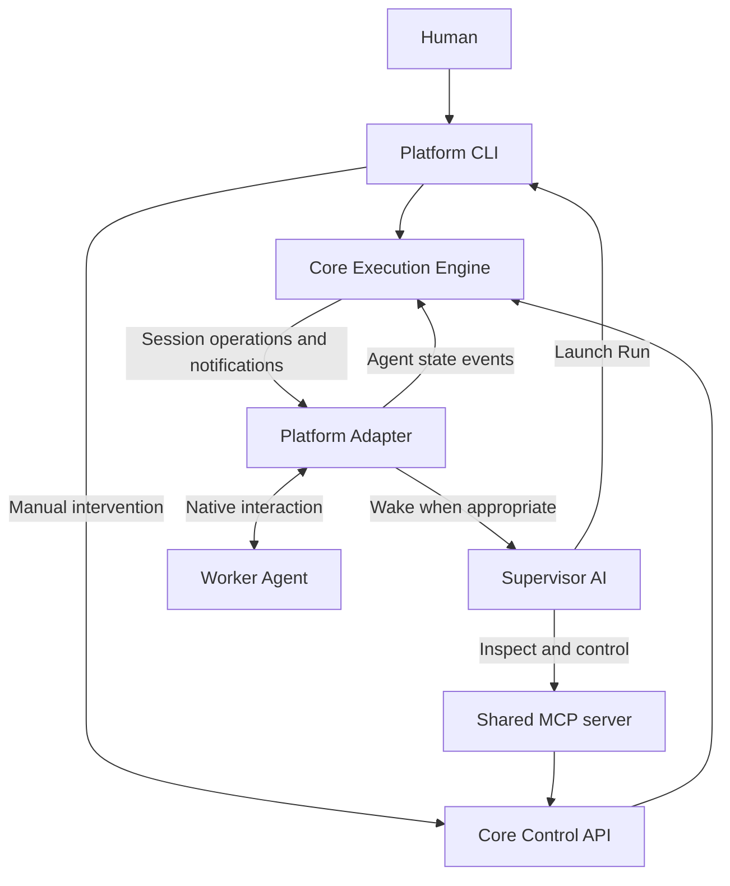
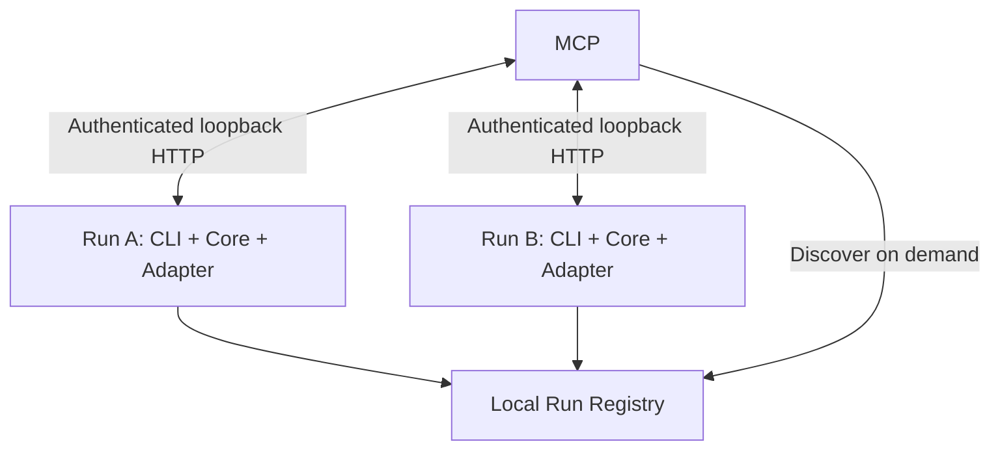
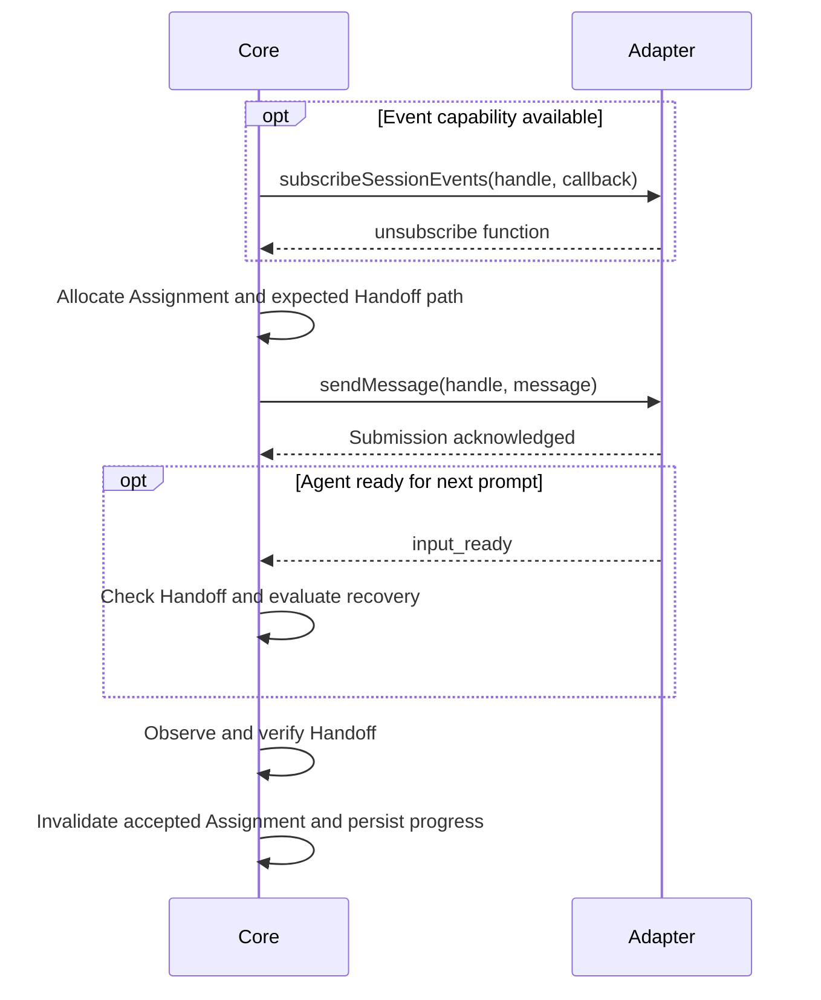
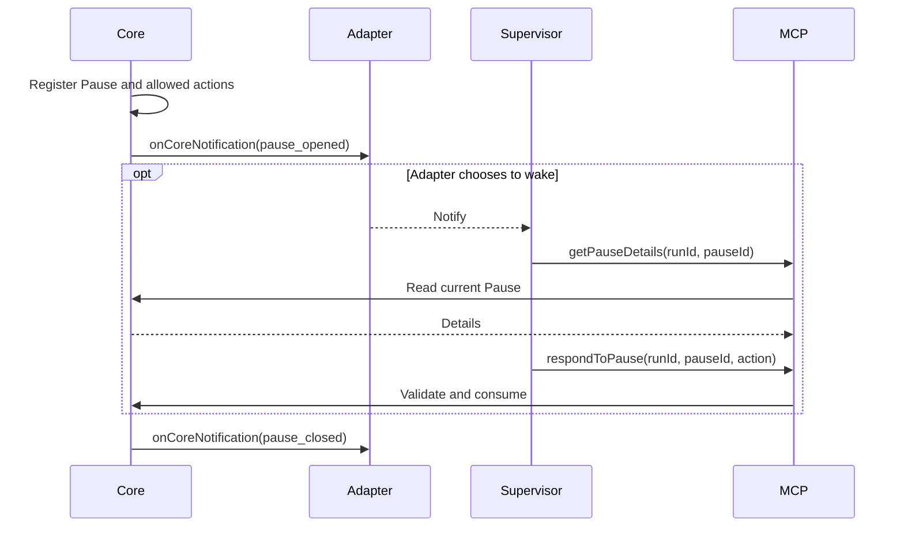
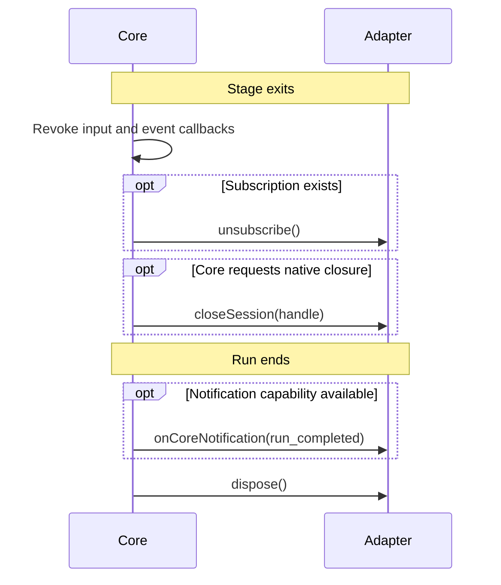

# Public integration contract

## Responsibilities and public entries



| Public entry | Consumer | Responsibility |
| --- | --- | --- |
| `issue-runner-core/cli` | Platform CLI | Run launch, manual interaction, MCP routing |
| `issue-runner-core/adapter` | Platform Adapter | Version, interfaces, and shared data types |
| `issue-runner-core/mcp` | CLI | Provider-independent MCP server |

Platform packages depend on Core and own their executables. CLI and MCP share the internal Core Control API.

## Shared identities and data

```typescript
// IDs are nonempty strings, Issue numbers are positive safe integers,
// and times use ISO 8601 UTC.
export type RunId = string; // Unique per live CLI invocation, including restart.
export type ExecutionId = string; // One Issue execution within a Run.
export type AssignmentId = string; // Core request with an expected Handoff.
export type MessageId = string; // Unique Core message submission.
export type PauseId = string; // Unique unresolved intervention.
export type NativeSessionReference = string; // Persistable native conversation ID.
export type SessionHandle = object; // Adapter-owned live target held in memory.

export type Stage =
  | "implement" | "review" | "fix_review"
  | "ci_repair" | "conflict_repair" | "documentation";

// Requested CLI work selection.
export type RunSelection =
  | { kind: "parent"; issueNumber: number }
  | { kind: "issue"; issueNumber?: number } // Omit to use configured issueList.
  | { kind: "document" }; // Core creates or restores the Maintenance Ticket.
```

```typescript
export interface RunIdentity {
  runId: RunId;
  project: string;
  repository: string;
  selection: RunSelection;
  targetBranch: string;
  autoMerge: boolean;
  startedAt: string; // ISO 8601 UTC.
}

// Include available, applicable facts.
export interface IssueContext {
  issueNumber: number;
  executionId?: ExecutionId;
  stage?: Stage;
  assignmentId?: AssignmentId;
  worktree?: string;
  nativeSessionReference?: NativeSessionReference;
}

export type WorkScope =
  | { kind: "run" }
  | { kind: "issue"; issue: IssueContext };
```

## CLI integration

```typescript
export interface CliOptions {
  commandName: string; // Installed platform executable name for help and errors.
  commandVersion: string; // Platform package version.
  adapter: PlatformAdapterModule; // Platform-provided versioned module.
}

// Reads process argv and cwd. Owns operator input and cancellation signals.
// Validates inputs before workflow effects. Sets process.exitCode and returns.
// Creates resources on invocation and removes process listeners on return.
export declare function runCli(options: CliOptions): Promise<void>;
```

```typescript
// Platform-owned executable.
import { runCli } from "issue-runner-core/cli";
import * as adapter from "./adapter.js";

await runCli({
  commandName: "issue-runner-platform",
  commandVersion: "1.0.0",
  adapter,
});
```

```text
init --project <key>
run --project <key> --parent <number>
run --project <key> --issue [<number>]
run --project <key> --document
--help
--version
mcp
```

- Preserve existing argument restrictions, configuration location, merge flags, manual confirmation behavior, and exit codes.
- Instantiate the Adapter for Run execution. Route mcp directly to the shared MCP server.
- Each Run executes in the launching CLI process.

## Platform Adapter interfaces

### Module and initialization

```typescript
export declare const adapterContractVersion: 1; // Independent of npm version.

export type PlatformAdapterConfig = Readonly<Record<string, unknown>>;

export interface PlatformAdapterModule {
  readonly contractVersion: typeof adapterContractVersion;
  // One instance per Run. Core validates version before invoking this factory.
  // Validate platform settings and native context; clean up untransferred
  // resources on failure. Core validates methods before workflow effects.
  // Validate each provided optional method.
  createPlatformAdapter(
    config: PlatformAdapterConfig, // platformAdapter mapping; defaults to {}.
  ): Promise<PlatformAdapter>;
}
```

### Session operations

```typescript
export interface SessionOptions {
  agent: string; // Opaque configured Agent ID used for validation and recovery.
  command: string; // Full start command or expanded resume command.
  cwd: string; // Absolute, existing stage work directory.
  label: string; // Display name.
  signal: AbortSignal; // Run cancellation plus Session revocation.
}

export interface ResumeSessionOptions extends SessionOptions {
  nativeSessionReference: NativeSessionReference; // Exact saved reference.
}

export interface OpenedSession {
  handle: SessionHandle; // Unique owned live target.
  nativeSessionReference?: NativeSessionReference; // Actual ID if reliable.
}

export interface AgentMessage {
  messageId: MessageId; // Fresh ID for this submission.
  assignmentId: AssignmentId; // Current Assignment, including identity Probe.
  text: string; // Complete prompt, correction, or recovery message.
}
```

```typescript
export interface PlatformAdapter {
  // Open a new owned Session; resolve when ready to receive input.
  startSession(options: SessionOptions): Promise<OpenedSession>;
  // Restore the exact conversation; resolve when ready for input.
  resumeSession(options: ResumeSessionOptions): Promise<OpenedSession>;
  // Resolve on acknowledged submission.
  // Preserve the LF-normalized text supplied by Core.
  sendMessage(handle: SessionHandle, message: AgentMessage): Promise<void>;
  // Close the owned representation; an already closed target is a success.
  closeSession(handle: SessionHandle): Promise<void>;
  // Core calls once per transferred instance, even after late initialization.
  // Release Run-level resources; preserve retained Sessions and history.
  // Preserve the Supervisor.
  dispose(): Promise<void>;

  // Optional. Return async, idempotent subscription cleanup.
  // Enables state-driven recovery during Assignment execution.
  subscribeSessionEvents?(
    handle: SessionHandle,
    onEvent: (event: AgentEvent) => void,
  ): Promise<() => Promise<void>>;

  // Optional. Receive Core notifications for platform-specific handling.
  onCoreNotification?(notification: CoreNotification): void | Promise<void>;
}
```

- Validate handle ownership and working directory support before operations. Target the Session identified by its handle.
- Core serializes input per Session, while independent Sessions run concurrently.
- Check the bound signal before new automatic operations. Revocation stops further input. Keep the input queue until the submission settles. Explicit cleanup may still target the same owned handle.
- The two optional methods are independent.

### Failure contract

Adapter manages resources before returning a Session Handle and throws `Error` on failure with any retained resource details. Core records errors and applies recovery policy, pausing on uncertain launch or submission outcomes.

## Optional capabilities

### Agent state events

```typescript
export type AgentEvent =
  | { type: "session_closed" } // Unexpected Session closure.
  | { type: "input_ready" }; // Execution ended; Agent can accept another ordinary prompt.
```

- Subscribe before dispatch. Adapter observes the Session throughout the subscription, reconciles interruptions, and pushes current events in order.
- On `input_ready`, Core checks the current Assignment's Handoff and applies its recovery policy.
- Adapter handles Agent requests for intervention through the platform and Supervisor AI. Core continues observing Handoff.

### Core notifications

```typescript
export interface ErrorDetail {
  code: string; // Machine-readable diagnostic.
  message: string; // Sanitized human-readable explanation.
}

export type PauseAction =
  | "continue" // Acknowledge the intervention.
  | "retry" // Repeat an eligible operation.
  | "restart" // Restart the affected workflow explicitly.
  | "skip" // Skip only when Core permits it.
  | "cancel"; // Request Run cancellation.

export interface PauseSummary {
  pauseId: PauseId;
  scope: WorkScope; // Affected Run or Issue.
  state: "active" | "queued"; // CLI confirmation state.
  message: string; // Human-readable intervention prompt.
  allowedActions: readonly PauseAction[]; // Actions legal at snapshot time.
}

export interface PauseDetails extends PauseSummary {
  openedAt: string; // ISO 8601 UTC.
  operation: string; // Core operation requiring intervention.
  reason: ErrorDetail;
  pullRequest?: PullRequestRef; // Diagnostic references, when applicable.
  handoffPath?: string;
  logPath?: string;
}
```

```typescript
// Emit after meaningful Core workflow transitions.
export type ProgressEvent =
  | "run_started" | "batch_started" | "batch_completed"
  | "issue_started" | "issue_completed"
  | "stage_started" | "stage_completed"
  | "pr_published" | "ci_wait_started" | "ci_wait_completed"
  | "merge_requested" | "merge_completed"
  | "cleanup_completed";

export interface NotificationBase {
  runId: RunId;
  project: string;
  repository: string;
  timestamp: string; // ISO 8601 UTC.
  sequence: number; // Notification order in this Run.
  message: string; // Display description.
}
```

```typescript
export type CoreNotification = NotificationBase & (
  // Emitted after a meaningful transition is committed.
  | {
      type: "progress";
      event: ProgressEvent;
      scope: WorkScope;
      pullRequest?: PullRequestRef;
    }
  | { type: "pause_opened"; pause: PauseDetails } // New Pause, including queue state.
  | { type: "pause_activated"; pause: PauseDetails } // Queued Pause becomes active.
  | {
      type: "pause_closed";
      pauseId: PauseId;
      scope: WorkScope;
      resolution: "responded" | "invalidated" | "cancelled";
      action?: PauseAction; // Present only when responded.
    }
  | { type: "run_completed"; summary: RunSummary } // Final reportable outcome.
);
```

- Adapter decides how to handle notifications and when to wake the Supervisor. Workflow control uses the Core Control API.
- Initiate asynchronous deliveries in sequence order. Report delivery failures separately. Dispatch the final outcome before orderly disposal.
- CLI displays actionable errors, Pause prompts, and control results independently of log recording. Proposed output policy: ordinary progress and final reporting use notifications.

## Configuration

```typescript
export interface AgentConfig {
  agent: string; // Nonempty Agent identifier.
  start: string; // Opaque, nonempty command; passed unchanged.
  resume: string; // Required {sessionref}; Core replaces each occurrence literally.
}

export type AgentProfiles = {
  implement: AgentConfig;
  ciRepair: AgentConfig;
  conflictRepair: AgentConfig;
  review?: AgentConfig; // Required when Review is enabled.
  documentation?: AgentConfig; // Required for documentation workflows.
};
```

```yaml
agents:
  implement:
    agent: codex
    start: 'codex --model gpt-5.4 -c model_reasoning_effort=high'
    resume: 'codex resume "{sessionref}"'

platformAdapter: {} # Adapter-owned settings; opaque to Core.
```

- Preserve role selection and the rest of Project configuration.
- Users specify Provider-specific model, effort, and launch arguments in commands. Adapter executes the command using its platform format.

## Core Control API and MCP

### State and result types

```typescript
export interface PullRequestRef {
  number: number;
  url: string;
  title?: string;
}

export type RunOutcome =
  | "succeeded" | "no_work" | "incomplete" | "cancelled" | "failed";

export type IssueOutcome =
  | "completed" | "pr_ready" | "no_change" | "no_work"
  | "incomplete" | "cancelled" | "failed";

export interface IssueResult {
  issue: IssueContext;
  kind: "delivery" | "maintenance";
  outcome: IssueOutcome;
  pullRequest?: PullRequestRef;
  detail: string; // Outcome explanation.
  retainedWorktrees: readonly string[];
}
```

```typescript
export interface RetainedEvidence {
  issueNumber?: number;
  executionId?: ExecutionId;
  recordedBranches: readonly string[];
  worktrees: readonly string[];
  paths: readonly string[];
}

export interface RunSummary {
  run: RunIdentity;
  outcome: RunOutcome;
  finishedAt: string; // ISO 8601 UTC.
  issues: readonly IssueResult[];
  failure?: ErrorDetail;
  retainedEvidence: readonly RetainedEvidence[];
  logPath?: string;
}
```

```typescript
// Expose existing workflow phases. Preserve checkpoint serialization.
export type IssuePhase =
  | "reserved" | "worktree_created" | "probing"
  | "implementing" | "implementation_completed"
  | "documenting" | "documentation_completed"
  | "reviewing" | "review_completed"
  | "fixing_review" | "fix_review_completed"
  | "repairing_ci" | "ci_repair_completed"
  | "repairing_conflict" | "conflict_repair_completed"
  | "publication_eligible";

export type PublicationPhase =
  | "pending_push" | "pushed" | "pending_pr" | "pr_created"
  | "checks_ready" | "checks_failed" | "conflict_repair"
  | "pending_merge" | "merge_requested" | "merged" | "delivered";
```

```typescript
export interface IssueStatus {
  issue: IssueContext;
  kind: "delivery" | "maintenance";
  phase?: IssuePhase;
  publicationPhase?: PublicationPhase;
  pullRequest?: PullRequestRef;
  handoffPath?: string; // Current expected Handoff path, if assigned.
  lastError?: ErrorDetail;
  result?: IssueResult;
}

// Core-owned workflow snapshot.
export interface RunStatus {
  run: RunIdentity;
  state: "running"
    | "paused" // Run-wide intervention; local Issue Pauses remain in pauses.
    | "cancelling"
    | "completed";
  issues: readonly IssueStatus[];
  pauses: readonly PauseSummary[]; // Active and queued unresolved Pauses.
  logPath?: string;
  summary?: RunSummary; // Only when a final outcome exists.
}
```

### Per-Run control

```typescript
export type ControlErrorCode =
  | "run_not_found" | "run_unavailable"
  | "pause_not_found" | "pause_not_active"
  | "action_not_allowed" | "run_ending"
  | "invalid_request" | "unauthorized" | "incompatible_version";

export type ControlResult<T> =
  | { ok: true; value: T }
  | { ok: false; error: ErrorDetail & { code: ControlErrorCode } };

// One live Run; CLI and MCP invoke the same operations.
interface RunControl {
  readonly runId: RunId;
  getStatus(): Promise<RunStatus>; // Read-only current snapshot.
  listPauses(): Promise<readonly PauseSummary[]>; // Active and queued.
  getPauseDetails(pauseId: PauseId): Promise<ControlResult<PauseDetails>>;
  // Check current identity, active state, and legal action atomically.
  // The first valid response consumes the active Pause.
  respondToPause(
    pauseId: PauseId, action: PauseAction,
  ): Promise<ControlResult<null>>;
  // Acknowledge the orderly Run cancellation request.
  cancel(): Promise<ControlResult<null>>;
}
```

- Proposed FIFO policy: inspect queued Pauses and respond to the active Pause. Each Pause carries its own scope.
- Preserve existing CLI key mappings.

### MCP startup and tools

```typescript
// issue-runner-core/mcp
// Started by the AI client through the platform CLI's mcp subcommand.
// Stdio transport: stdout carries protocol traffic, stderr carries diagnostics.
// Connects to independently running CLI instances.
export declare function runMcp(): Promise<void>;
```

```json
{
  "mcpServers": {
    "issue-runner": {
      "command": "issue-runner-platform",
      "args": ["mcp"]
    }
  }
}
```

```typescript
export interface LiveRun {
  run: RunIdentity;
  state: RunStatus["state"];
}

// MCP input and structured result schemas.
// Same tool names across platform CLIs. External operations target a live Run.
export interface McpTools {
  listRuns(): Promise<ControlResult<readonly LiveRun[]>>; // Discover live Runs.
  getRunStatus(input: { runId: RunId }): Promise<ControlResult<RunStatus>>;
  listPauses(input: { runId: RunId }): Promise<ControlResult<readonly PauseSummary[]>>;
  getPauseDetails(input: {
    runId: RunId; pauseId: PauseId;
  }): Promise<ControlResult<PauseDetails>>;
  respondToPause(input: {
    runId: RunId; pauseId: PauseId; action: PauseAction;
  }): Promise<ControlResult<null>>;
  cancelRun(input: { runId: RunId }): Promise<ControlResult<null>>;
}
```

### Local Run discovery



- Publish one record per Run under `~/.issue-runner/active-runs/` once its endpoint is ready. Record the Run identity and connection details.
- Bind an authorized endpoint to a loopback address on an available port. Keep connection credentials private to the local transport with OS-user access controls.
- Validate live Run identity, compatibility, and authorization on demand and before control. Route control to the exact Run ID.
- Discover live Runs on demand on the local machine. Unregister on orderly exit.
- Private registry and HTTP wire schemas remain separate design work.

## Lifecycle and failure flows

### Startup and exact resume


- Adapter establishes readiness before returning the Session.
- Core prioritizes reliable native identity evidence, falling back to the existing identity-only Probe and correction flow.
- Require a nonempty identifier of the actual native conversation, obtained from native evidence or the identity Probe.
- Keep checkpoint identity fields `sessionid`, `agent`, and expanded `resume`. Validate the current profile and exact actual reference; persist identity before formal work.
- Verify the exact expected conversation before dispatch; otherwise pause and preserve evidence.

### Assignment and Handoff



- Core owns prompt content, Assignments, Handoff verification, and recovery policy. Handoff verification establishes task completion.
- Recovery and correction messages use fresh message IDs, the applicable Assignment ID, and the same owned Session. Evaluate recovery for the current active Assignment using current events.
- Adapter reports facts; Core determines whether to retry or require intervention.

### Pause and notification



The CLI and MCP respond through the same control operation using the current active Pause state.

### Stage exit and Run disposal



- Revoke automatic capabilities permanently on every Stage exit and cancel late-transferred subscriptions immediately.
- Preserve accepted Handoff and checkpoint progress before cleanup. Retry cleanup on the original owned target; retain and report incomplete resources.
- Dispose once on every orderly Run exit after final notification dispatch and Session cleanup attempts. Preserve retained Sessions and native history.

## Remaining decisions

| Subsequent decision | Refines after contract approval |
| --- | --- |
| [Agent Lifecycle and Event Model](https://github.com/BuddyLabsCo/issue-runner-core/issues/474) | Event semantics and subscription lifecycle |
| [Core-Owned Agent Recovery Policy](https://github.com/BuddyLabsCo/issue-runner-core/issues/475) | Recovery triggers, limits and Handoff handling |
| [Structured Run Control and Pause Management](https://github.com/BuddyLabsCo/issue-runner-core/issues/476) | Pause policies, valid actions and races |
| [Notification Contract and Terminal Output](https://github.com/BuddyLabsCo/issue-runner-core/issues/477) | Event inventory, payload semantics, output and delivery behavior |
| [Breaking Migration and Core Acceptance Criteria](https://github.com/BuddyLabsCo/issue-runner-core/issues/478) | Migration and acceptance |
