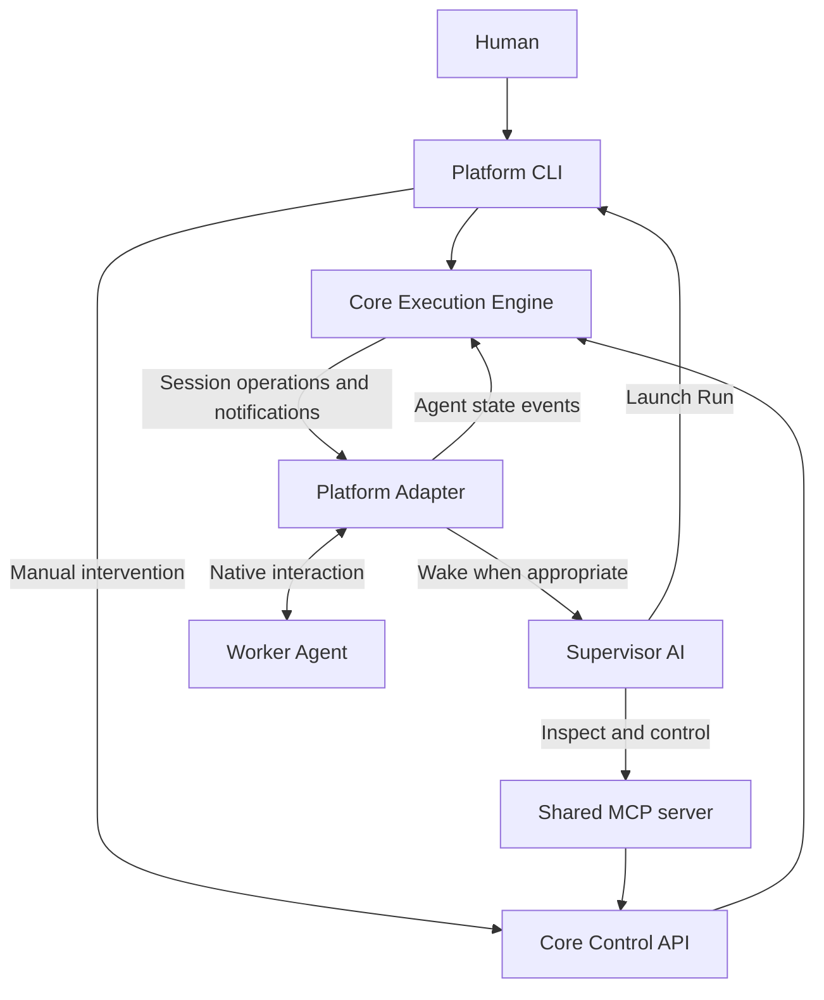
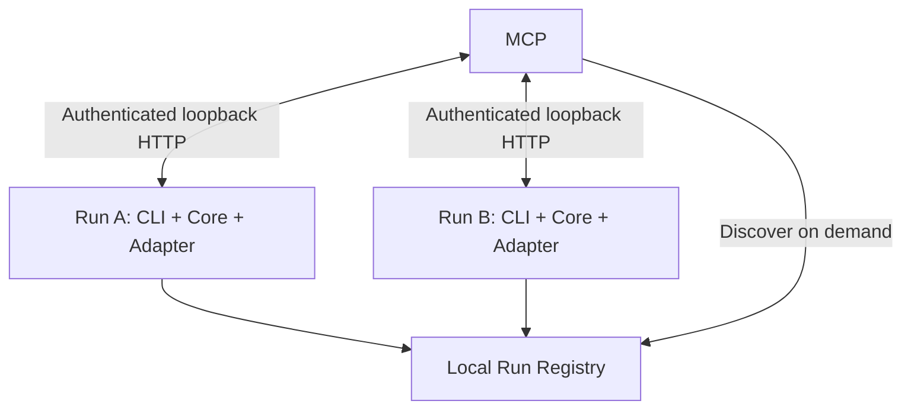
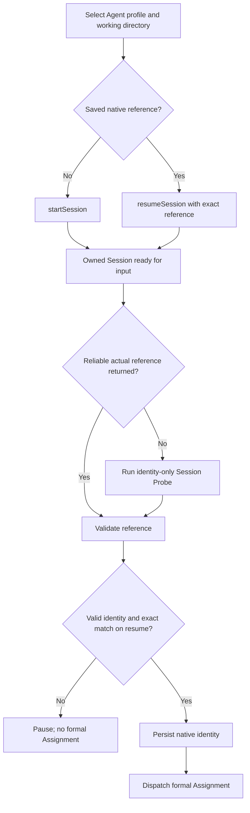
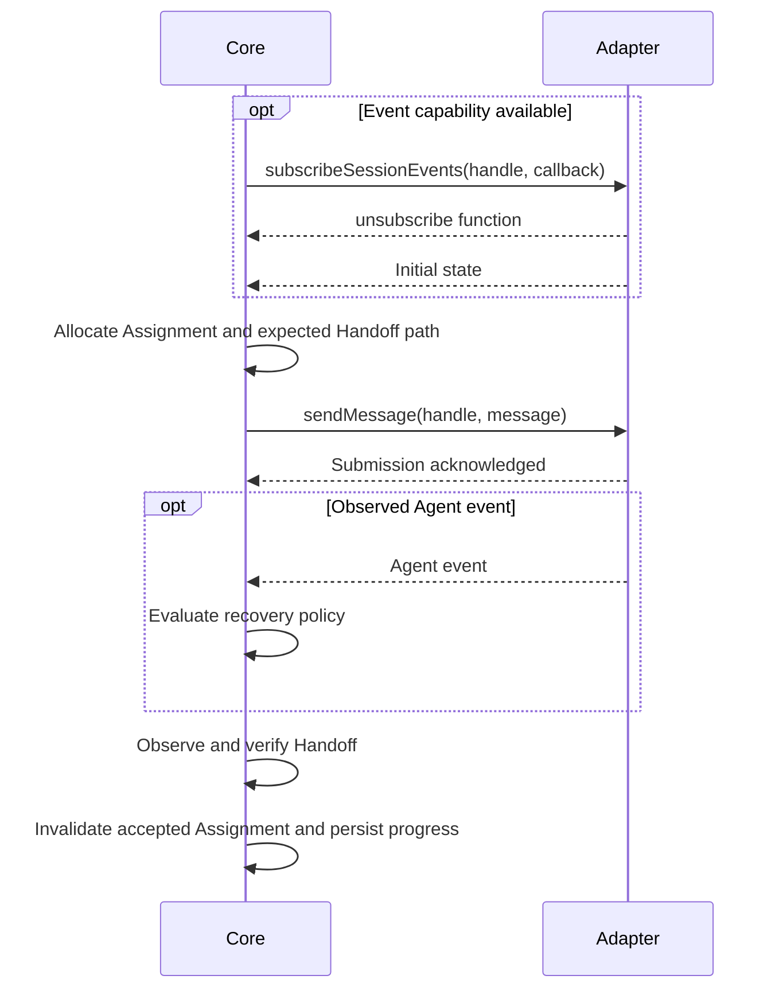
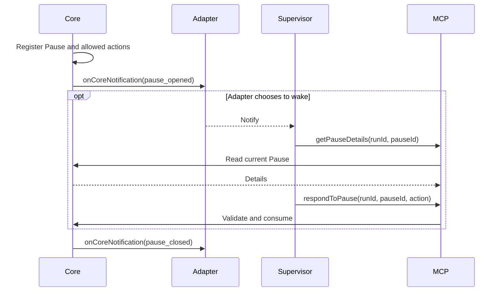
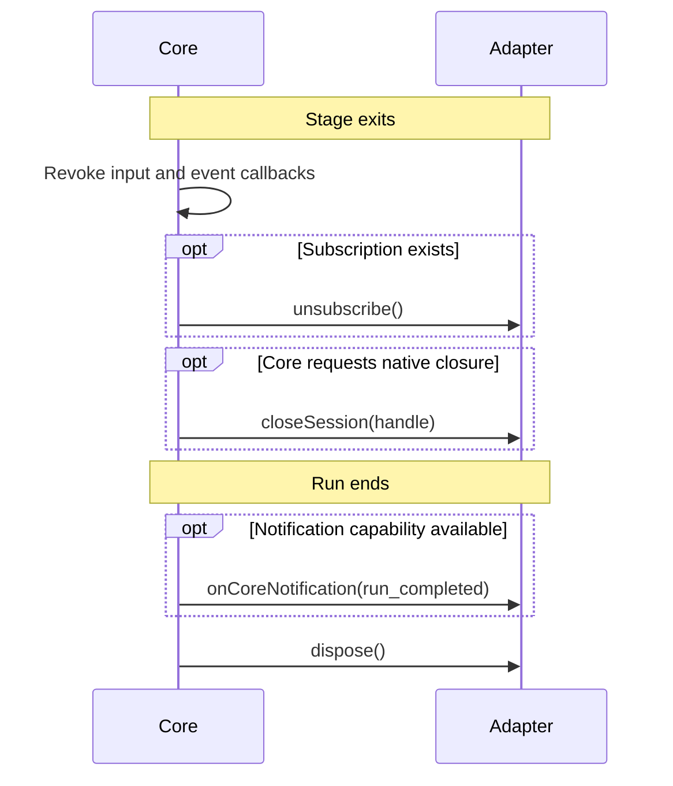

# Public integration contract

## Responsibilities and public entries



| Public entry | Consumer | Responsibility |
| --- | --- | --- |
| `issue-runner-core/cli` | Platform CLI | Run launch, manual interaction, MCP routing |
| `issue-runner-core/adapter` | Platform Adapter | Version, interfaces, and shared data types |
| `issue-runner-core/mcp` | CLI | Provider-independent MCP server |

Platform packages depend on Core and own their executables. Core registers no executable. The internal Core Control API is shared by CLI and MCP, not a separate public SDK.

## Shared identities and data

```typescript
// IDs are nonempty strings, Issue numbers are positive safe integers,
// and times use ISO 8601 UTC.
export type RunId = string; // Unique per live CLI invocation, including restart.
export type ExecutionId = string; // One Issue execution within a Run.
export type AssignmentId = string; // Core request with an expected Handoff.
export type MessageId = string; // Unique Core message submission.
export type PauseId = string; // Unique unresolved intervention.
export type NativeSessionReference = string; // Persistable native conversation ID.
export type SessionHandle = object; // Live, Adapter-owned; never persisted.

export type Stage =
  | "implement" | "review" | "fix_review"
  | "ci_repair" | "conflict_repair" | "documentation";

// CLI selection, not the set of Issues discovered during execution.
export type RunSelection =
  | { kind: "parent"; issueNumber: number }
  | { kind: "issue"; issueNumber?: number } // Omit to use configured issueList.
  | { kind: "document" }; // Core creates or restores the Maintenance Ticket.
```

```typescript
export interface RunIdentity {
  runId: RunId; // Historical checkpoint IDs are not live control targets.
  project: string;
  repository: string;
  selection: RunSelection;
  targetBranch: string;
  autoMerge: boolean;
  startedAt: string; // ISO 8601 UTC.
}

// Omit facts that are unknown or not applicable.
export interface IssueContext {
  issueNumber: number; // Positive safe integer; not an execution identity.
  executionId?: ExecutionId;
  stage?: Stage;
  assignmentId?: AssignmentId;
  worktree?: string;
  nativeSessionReference?: NativeSessionReference;
}

export type WorkScope =
  | { kind: "run" }
  | { kind: "issue"; issue: IssueContext };
```

Public snapshots and notifications contain JSON-compatible values. Never serialize Session Handles, credentials, AbortSignals, secret-bearing commands, or raw Errors.

## CLI integration

```typescript
export interface CliOptions {
  commandName: string; // Installed platform executable name for help and errors.
  commandVersion: string; // Platform package version; not recovery identity.
  adapter: PlatformAdapterModule; // Explicit versioned module, no discovery.
}

// Reads process argv and cwd. Owns operator input and cancellation signals.
// Validates inputs before workflow effects. Sets exitCode without exiting.
// Removes process listeners on return; imports must not create resources.
export declare function runCli(options: CliOptions): Promise<void>;
```

```typescript
// Platform-owned executable.
import { runCli } from "issue-runner-core/cli";
import * as adapter from "./adapter.js";

await runCli({
  commandName: "issue-runner-platform",
  commandVersion: "1.0.0",
  adapter,
});
```

```text
init --project <key>
run --project <key> --parent <number>
run --project <key> --issue [<number>]
run --project <key> --document
--help
--version
mcp
```

- Preserve existing argument restrictions, configuration location, merge flags, manual confirmation behavior, and exit codes.
- Help, version, init, and mcp do not instantiate an Adapter. The platform CLI forwards mcp without environment checks, Project loading, or platform authorization preflight.
- Each Run executes in the launching CLI process. No central workflow daemon.

## Platform Adapter interfaces

### Module and initialization

```typescript
export declare const adapterContractVersion: 1; // Independent of npm version.

export type PlatformAdapterConfig = Readonly<Record<string, unknown>>;

export interface PlatformAdapterModule {
  readonly contractVersion: typeof adapterContractVersion;
  // One instance per Run. Core validates version before invoking this factory.
  // Validate platform settings and native context; clean up untransferred
  // resources on failure. Core validates methods before workflow effects.
  // Missing optional methods are valid; malformed methods are not.
  createPlatformAdapter(
    config: PlatformAdapterConfig, // platformAdapter mapping; defaults to {}.
  ): Promise<PlatformAdapter>;
}
```

### Session operations

```typescript
export interface SessionOptions {
  agent: string; // Configured Agent ID; opaque except validation and recovery.
  command: string; // Full start command or expanded resume command.
  cwd: string; // Absolute, existing stage work directory. Reject invalid context.
  label: string; // Display name only, never a routing identity.
  signal: AbortSignal; // Run cancellation plus Session revocation.
}

export interface ResumeSessionOptions extends SessionOptions {
  nativeSessionReference: NativeSessionReference; // Exact saved reference.
}

export interface OpenedSession {
  handle: SessionHandle; // Unique owned live target.
  nativeSessionReference?: NativeSessionReference; // Actual ID if reliable.
}

export interface AgentMessage {
  messageId: MessageId; // Fresh ID for this submission.
  assignmentId: AssignmentId; // Current Assignment, including identity Probe.
  text: string; // Complete prompt, correction, or recovery message.
}
```

```typescript
export interface PlatformAdapter {
  // Open a new owned Session; resolve only when ready to receive input.
  startSession(options: SessionOptions): Promise<OpenedSession>;
  // Restore the exact conversation; resolve when ready for input.
  resumeSession(options: ResumeSessionOptions): Promise<OpenedSession>;
  // Resolve on acknowledged submission, not Agent completion.
  // Preserve text except Core's existing LF normalization.
  sendMessage(handle: SessionHandle, message: AgentMessage): Promise<void>;
  // Close only this owned representation; already absent is allowed.
  closeSession(handle: SessionHandle): Promise<void>;
  // Core calls once per transferred instance, even after late initialization.
  // Release Run-level resources; preserve retained Sessions and history.
  // Never close the Supervisor. A resource-free Adapter may do nothing.
  dispose(): Promise<void>;

  // Optional. Return async, idempotent subscription cleanup.
  // Without it, Handoff and manual control continue; no state-driven recovery.
  subscribeSessionEvents?(
    handle: SessionHandle,
    onEvent: (event: AgentEvent) => void,
  ): Promise<() => Promise<void>>;

  // Optional. Handle or ignore notifications; never authorize workflow changes.
  // Without it, manual CLI and MCP control remain; no Supervisor wake-up.
  onCoreNotification?(notification: CoreNotification): void | Promise<void>;
}
```

- Reject foreign handles and unsupported working directories; never redirect targets.
- Core serializes input per Session, while independent Sessions run concurrently.
- Check the bound signal before new automatic operations. Revocation prevents new input, not rollback. Keep the input queue until the submission settles. Explicit cleanup may still target the same owned handle.
- The two optional methods are independent.

### Failure contract

```typescript
export interface AdapterOperationError extends Error {
  effect: "none" // Adapter knows the requested operation had no effect.
    | "applied" // The operation's effect is known.
    | "unknown"; // The effect cannot be established.
  code: string; // Adapter-specific machine-readable diagnostic.
  handle?: SessionHandle; // Owned target if known.
}

export interface SessionReadinessError extends AdapterOperationError {
  effect: "applied"; // Launch succeeded but readiness failed.
  handle: SessionHandle;
  // Retry readiness of this exact Session; do not launch another.
  retryReadiness(): Promise<OpenedSession>;
}
```

Core reports malformed and uncertain outcomes, pauses instead of blindly replaying launch or submission, and retains identifiable resources. Unstructured errors and timeouts do not prove no effect. Report cleanup failures separately.

## Optional capabilities

### Agent state events

```typescript
export type AgentState =
  | "idle" | "running" | "waiting_for_input" | "unknown";

export interface AgentEventBase {
  sequence: number; // Positive increasing sequence within this subscription.
  timestamp: string; // Observed time, ISO 8601 UTC.
  messageId?: MessageId; // Exact Core message correlation, if established.
  nativeTurnId?: string; // Native turn ID, not an Assignment ID.
}

export type AgentEvent = AgentEventBase & (
  // Initial or changed state; not a Handoff result.
  | { type: "state"; state: AgentState; detail?: string }
  // Observed actual end of a specific turn, when known.
  | {
      type: "turn_ended";
      outcome: "completed" | "failed" | "cancelled";
      error?: ErrorDetail;
    }
  | { type: "session_closed"; error?: ErrorDetail } // Native Session ended.
  | { type: "observation_lost"; error: ErrorDetail } // Cannot observe reliably.
  | { type: "observation_restored"; state: AgentState } // Reconciled current state.
);
```

- Subscribe before dispatch. Deliver initial state and subsequent facts without a gap; reconcile after observation loss.
- The callback is bound to its Session Handle. Do not infer message or turn identity from arrival order. Uncorrelated events cannot establish Assignment completion or authorize replay.
- Adapter normalizes duplicates and ordering where possible; Core rejects stale callbacks and non-increasing sequence values.
- No Agent-state polling fallback. Handoff and deterministic GitHub observation remain unchanged.

### Core notifications

```typescript
export interface ErrorDetail {
  code: string; // Machine-readable diagnostic.
  message: string; // Sanitized human-readable explanation.
}

export type PauseAction =
  | "continue" // Acknowledge the intervention.
  | "retry" // Repeat an eligible operation.
  | "restart" // Restart the affected workflow explicitly.
  | "skip" // Skip only when Core permits it.
  | "cancel"; // Request Run cancellation.

export interface PauseSummary {
  pauseId: PauseId;
  scope: WorkScope; // Affected Run or Issue, independent of queue position.
  state: "active" | "queued"; // CLI confirmation state.
  message: string; // Human-readable intervention prompt.
  allowedActions: readonly PauseAction[]; // Actions legal at snapshot time.
}

export interface PauseDetails extends PauseSummary {
  openedAt: string; // ISO 8601 UTC.
  operation: string; // Core operation requiring intervention.
  reason: ErrorDetail;
  pullRequest?: PullRequestRef; // Diagnostic references, when applicable.
  handoffPath?: string;
  logPath?: string;
}
```

```typescript
// Emit after meaningful Core workflow transitions.
export type ProgressEvent =
  | "run_started" | "batch_started" | "batch_completed"
  | "issue_started" | "issue_completed"
  | "stage_started" | "stage_completed"
  | "pr_published" | "ci_wait_started" | "ci_wait_completed"
  | "merge_requested" | "merge_completed"
  | "cleanup_completed";

export interface NotificationBase {
  runId: RunId;
  project: string;
  repository: string;
  timestamp: string; // ISO 8601 UTC.
  sequence: number; // Notification order in this Run.
  message: string; // Display description, not a control instruction.
}
```

```typescript
export type CoreNotification = NotificationBase & (
  // Emitted after a meaningful transition is committed.
  | {
      type: "progress";
      event: ProgressEvent;
      scope: WorkScope;
      pullRequest?: PullRequestRef;
    }
  | { type: "pause_opened"; pause: PauseDetails } // New Pause, including queue state.
  | { type: "pause_activated"; pause: PauseDetails } // Queued Pause becomes active.
  | {
      type: "pause_closed";
      pauseId: PauseId;
      scope: WorkScope;
      resolution: "responded" | "invalidated" | "cancelled";
      action?: PauseAction; // Present only when responded.
    }
  | { type: "run_completed"; summary: RunSummary } // Final reportable outcome.
);
```

- Adapter chooses whether to display, ignore, or wake the Supervisor. Notification delivery neither resolves a Pause nor authorizes a workflow mutation.
- Dispatch in sequence order without waiting on prior asynchronous deliveries. Report rejection without replaying the workflow. Dispatch final outcome before disposal when available; hard termination may prevent delivery.
- CLI displays actionable errors, Pause prompts, and control results independently of log recording. Proposed output policy: ordinary progress and final reporting use notifications.

## Configuration

```typescript
export interface AgentConfig {
  agent: string; // Nonempty Agent identifier.
  start: string; // Opaque, nonempty command; passed unchanged.
  resume: string; // Required {sessionref}; Core replaces each occurrence literally.
}

export type AgentProfiles = {
  implement: AgentConfig;
  ciRepair: AgentConfig;
  conflictRepair: AgentConfig;
  review?: AgentConfig; // Required when Review is enabled.
  documentation?: AgentConfig; // Required for documentation workflows.
};
```

```yaml
agents:
  implement:
    agent: codex
    start: 'codex --model gpt-5.4 -c model_reasoning_effort=high'
    resume: 'codex resume "{sessionref}"'

platformAdapter: {} # Adapter-owned settings; opaque to Core.
```

- Preserve role selection and the rest of Project configuration.
- Users specify Provider-specific model, effort, and launch arguments in commands. Adapter understands its platform format, not per-Provider parameter translation.
- Remove terminalPlugins, enhancements, agentStartDelay, submitKey, unused per-Agent options, and Core environment overlays.

## Core Control API and MCP

### State and result types

```typescript
export interface PullRequestRef {
  number: number;
  url: string;
  title?: string;
}

export type RunOutcome =
  | "succeeded" | "no_work" | "incomplete" | "cancelled" | "failed";

export type IssueOutcome =
  | "completed" | "pr_ready" | "no_change" | "no_work"
  | "incomplete" | "cancelled" | "failed";

export interface IssueResult {
  issue: IssueContext;
  kind: "delivery" | "maintenance";
  outcome: IssueOutcome;
  pullRequest?: PullRequestRef;
  detail: string; // Outcome explanation.
  retainedWorktrees: readonly string[];
}
```

```typescript
export interface RetainedEvidence {
  issueNumber?: number;
  executionId?: ExecutionId;
  recordedBranches: readonly string[];
  worktrees: readonly string[];
  paths: readonly string[];
}

export interface RunSummary {
  run: RunIdentity;
  outcome: RunOutcome;
  finishedAt: string; // ISO 8601 UTC.
  issues: readonly IssueResult[];
  failure?: ErrorDetail;
  retainedEvidence: readonly RetainedEvidence[];
  logPath?: string;
}
```

```typescript
// Expose existing workflow phases without changing checkpoint serialization.
export type IssuePhase =
  | "reserved" | "worktree_created" | "probing"
  | "implementing" | "implementation_completed"
  | "documenting" | "documentation_completed"
  | "reviewing" | "review_completed"
  | "fixing_review" | "fix_review_completed"
  | "repairing_ci" | "ci_repair_completed"
  | "repairing_conflict" | "conflict_repair_completed"
  | "publication_eligible";

export type PublicationPhase =
  | "pending_push" | "pushed" | "pending_pr" | "pr_created"
  | "checks_ready" | "checks_failed" | "conflict_repair"
  | "pending_merge" | "merge_requested" | "merged" | "delivered";
```

```typescript
export interface IssueStatus {
  issue: IssueContext;
  kind: "delivery" | "maintenance";
  phase?: IssuePhase;
  publicationPhase?: PublicationPhase;
  pullRequest?: PullRequestRef;
  handoffPath?: string; // Current expected Handoff path, if assigned.
  lastError?: ErrorDetail;
  result?: IssueResult;
}

// Core-owned snapshot, not native conversation history.
export interface RunStatus {
  run: RunIdentity;
  state: "running"
    | "paused" // Run-wide intervention; local Issue Pauses remain in pauses.
    | "cancelling"
    | "completed";
  issues: readonly IssueStatus[];
  pauses: readonly PauseSummary[]; // Active and queued unresolved Pauses.
  logPath?: string;
  summary?: RunSummary; // Only when a final outcome exists.
}
```

### Per-Run control

```typescript
export type ControlErrorCode =
  | "run_not_found" | "run_unavailable"
  | "pause_not_found" | "pause_not_active"
  | "action_not_allowed" | "run_ending"
  | "invalid_request" | "unauthorized" | "incompatible_version";

export type ControlResult<T> =
  | { ok: true; value: T }
  | { ok: false; error: ErrorDetail & { code: ControlErrorCode } };

// One live Run; CLI and MCP invoke the same operations.
interface RunControl {
  readonly runId: RunId;
  getStatus(): Promise<RunStatus>; // Read-only current snapshot.
  listPauses(): Promise<readonly PauseSummary[]>; // Active and queued.
  getPauseDetails(pauseId: PauseId): Promise<ControlResult<PauseDetails>>;
  // Check current identity, active state, and legal action atomically.
  // First valid response consumes the Pause; reject stale or duplicate input.
  respondToPause(
    pauseId: PauseId, action: PauseAction,
  ): Promise<ControlResult<null>>;
  // Acknowledge orderly Run cancellation; not completion.
  cancel(): Promise<ControlResult<null>>;
}
```

- Proposed FIFO policy: queued Pauses are inspectable but not answerable until active. The confirmation queue does not determine workflow Pause scope.
- Preserve existing CLI key mappings. No proactive pause, arbitrary internal mutation, direct Worker Agent input, or conversation history reader.

### MCP startup and tools

```typescript
// issue-runner-core/mcp
// Started by the AI client through the platform CLI's mcp subcommand.
// Stdio only; stdout carries protocol traffic, stderr carries diagnostics.
// No Adapter initialization or Run launch. Disconnect does not cancel Runs.
export declare function runMcp(): Promise<void>;
```

```json
{
  "mcpServers": {
    "issue-runner": {
      "command": "issue-runner-platform",
      "args": ["mcp"]
    }
  }
}
```

```typescript
export interface LiveRun {
  run: RunIdentity;
  state: RunStatus["state"];
}

// MCP input and structured result schemas, not a public TypeScript client.
// Same tool names across platform CLIs. External operations target a live Run.
export interface McpTools {
  listRuns(): Promise<ControlResult<readonly LiveRun[]>>; // Live discovery only.
  getRunStatus(input: { runId: RunId }): Promise<ControlResult<RunStatus>>;
  listPauses(input: { runId: RunId }): Promise<ControlResult<readonly PauseSummary[]>>;
  getPauseDetails(input: {
    runId: RunId; pauseId: PauseId;
  }): Promise<ControlResult<PauseDetails>>;
  respondToPause(input: {
    runId: RunId; pauseId: PauseId; action: PauseAction;
  }): Promise<ControlResult<null>>;
  cancelRun(input: { runId: RunId }): Promise<ControlResult<null>>;
}
```

### Local Run discovery



- Publish one record per Run under `~/.issue-runner/active-runs/` once its endpoint is ready. It identifies the Run and connection, not workflow state.
- Use an authorized loopback-only endpoint on an available port. Protect connection credentials with OS-user access controls; never return them from MCP.
- Validate live Run identity on demand and before control. Reject stale, incompatible, or unauthorized records. Port or process reuse cannot select another Run.
- Unregister on orderly exit. No daemon, periodic polling, cross-machine discovery, or separate Core installation.
- Private registry and HTTP wire schemas remain separate design work.

## Lifecycle and failure flows

### Startup and exact resume



- Adapter establishes readiness; no fixed Core startup delay.
- Core uses the existing identity-only Probe and correction flow only when a trustworthy reference is unavailable. Probe evidence is Agent-reported and does not replace stronger native evidence where available.
- Reject empty references, latest/last selectors, Run or execution IDs, and platform routing IDs masquerading as native conversation identities. A requested resume ID is not proof of the actual restored identity.
- Keep checkpoint identity fields `sessionid`, `agent`, and expanded `resume`. Validate the current profile and exact actual reference; persist identity before formal work.
- A known Session that fails readiness may be rechecked through its provided readiness continuation; never relaunch after an uncertain result.
- If the expected conversation cannot be verified, pause and preserve the evidence. Never silently substitute another conversation.

### Assignment and Handoff



- Core owns prompt content, Assignments, Handoff verification, and recovery policy. Native Agent state does not establish task completion.
- Recovery and correction messages use fresh message IDs, the applicable Assignment ID, and the same owned Session. Stale events cannot authorize recovery for a replaced or accepted Assignment.
- Remove the old Enhancement recovery and pause callbacks. Adapter reports facts; Core determines whether to retry or require intervention.

### Pause and notification



The CLI can respond through the same control operation at any time the Pause is active. Neither notification delivery nor a stale notification determines the current Pause state.

### Stage exit and Run disposal



- Revoke automatic capabilities on every Stage exit and cancel late-transferred subscriptions immediately. A cleanup failure cannot reactivate a callback.
- Preserve accepted Handoff and checkpoint progress before cleanup. Retry cleanup only on the same owned target; retain and report incomplete resources.
- Dispose once on every orderly Run exit after final notification dispatch and Session cleanup attempts. Do not close retained Sessions or delete native history.

## Remaining decisions

| Subsequent decision | Refines after contract approval |
| --- | --- |
| [Agent Lifecycle and Event Model](https://github.com/BuddyLabsCo/issue-runner-core/issues/474) | Event classification, correlation and ordering, observation loss |
| [Core-Owned Agent Recovery Policy](https://github.com/BuddyLabsCo/issue-runner-core/issues/475) | Recovery triggers, limits and Handoff handling |
| [Structured Run Control and Pause Management](https://github.com/BuddyLabsCo/issue-runner-core/issues/476) | Pause policies, valid actions and races |
| [Notification Contract and Terminal Output](https://github.com/BuddyLabsCo/issue-runner-core/issues/477) | Event inventory, payload semantics, output and delivery behavior |
| [Breaking Migration and Core Acceptance Criteria](https://github.com/BuddyLabsCo/issue-runner-core/issues/478) | Migration and acceptance |
