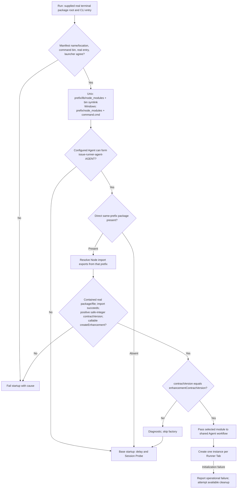
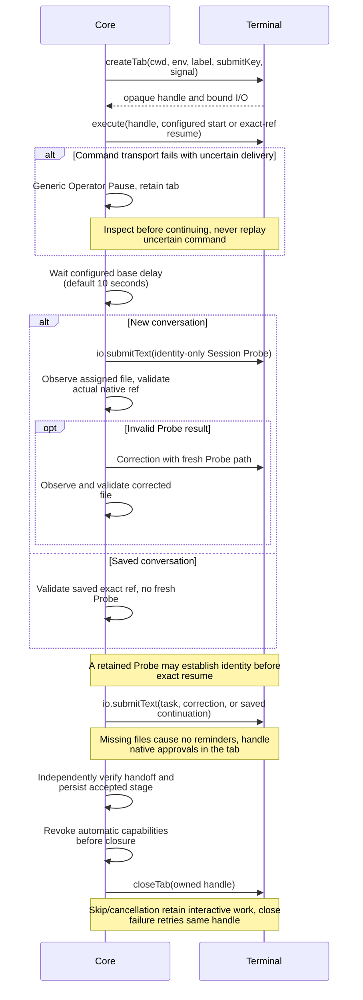
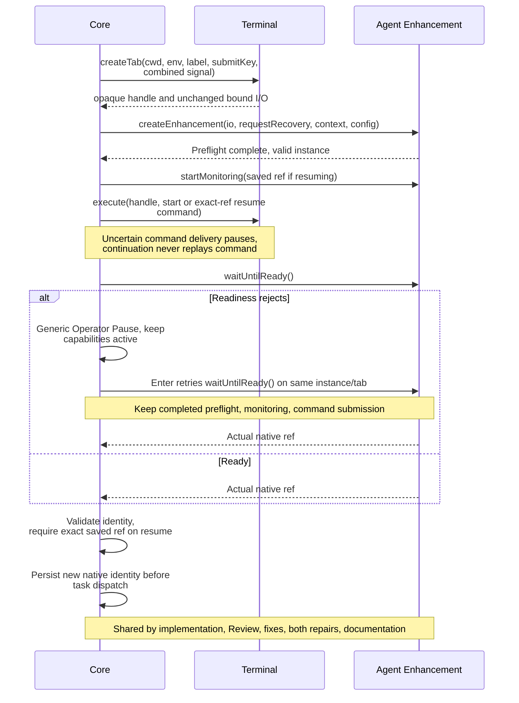
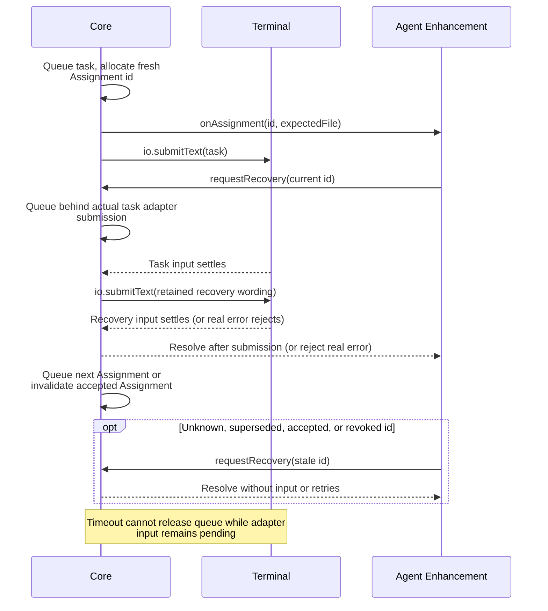
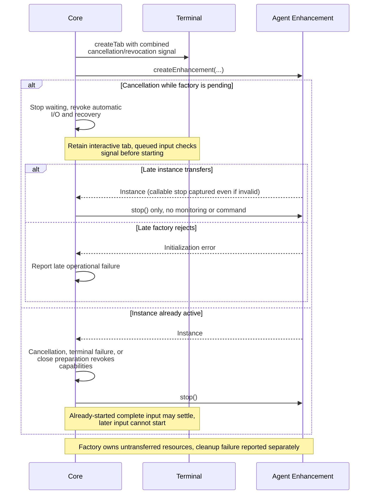
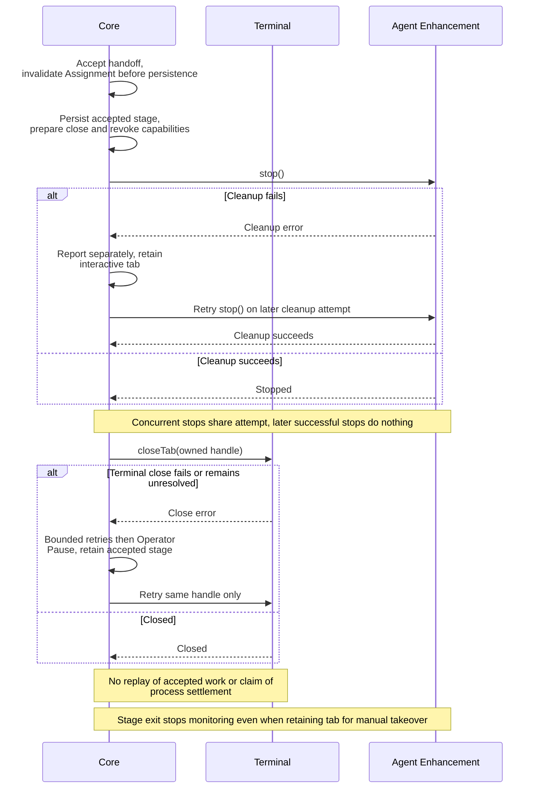

# Public integration contract

Terminal packages own the executable and terminal I/O. Core owns the workflow and conversations. Agent enhancements provide native readiness and monitoring.

## Responsibilities and public entries

```typescript
// Runtime consumers must declare Core in dependencies.
import { runCli, type CliOptions } from "issue-runner-core/cli";
import {
  terminalContractVersion, // 2; independent of npm version
  enhancementContractVersion, // 3; independent of terminal contract version
} from "issue-runner-core/terminal";
// Type-only consumers can declare Core in devDependencies.
import type {
  TerminalPluginModule, TerminalPlugin, TerminalIO,
  CreateTabOptions, TabHandle, EnhancementModule, Enhancement,
  EnhancementContext, RequestRecovery,
} from "issue-runner-core/terminal";
```

Only `/cli` and `/terminal` are public entries. Core registers no executable. See the [README](../README.md#developing-core) for build and consumer checks.

## Terminal CLI integration

```typescript
export interface CliOptions {
  commandName: string; // Executing command; used in help, errors and recovery identity.
  commandVersion: string; // Terminal package version; excluded from recovery identity.
  terminal: TerminalPluginModule; // Lazy factory; imports must not create tabs.
  terminalPackageRoot: string; // Absolute real path to the installed terminal package.
  terminalCliEntry: string; // Absolute real path to its executing CLI entry.
}

// Reads process argv/cwd/env; validates inputs before terminal creation or workflow effects.
// Help/version/init need no credentials or terminal factory; init refuses overwrite.
// Owns operator input and SIGINT/SIGTERM cancellation; removes listeners on return.
// Sets exitCode to 0 or 1 without exiting. Importing this entry has no side effects.
export function runCli(options: CliOptions): Promise<void>;
```

```typescript
// Terminal-owned executable at the package root; adjust the root for a bin/ entry.
import { realpathSync } from "node:fs";
import { fileURLToPath } from "node:url";
import { runCli } from "issue-runner-core/cli";
import * as terminal from "./terminal.js";

await runCli({
  commandName: "generic-terminal",
  commandVersion: "1.0.0",
  terminal,
  terminalPackageRoot: realpathSync(fileURLToPath(new URL(".", import.meta.url))),
  terminalCliEntry: realpathSync(fileURLToPath(import.meta.url)),
});
```

## Terminal interfaces and bound I/O

```typescript
export const terminalContractVersion = 2 as const;

// Owned by one plugin instance; Core never inspects or persists it.
export type TabHandle = object;

export interface TerminalPluginModule {
  readonly contractVersion: typeof terminalContractVersion;
  // Called once with the full terminalPlugins mapping, including generic defaults.
  // Core validates version and returned methods before workflow effects; failures abort startup.
  // Cancellation waits for this factory to settle. Default parameters are supported.
  createTerminalPlugin(config: unknown): Promise<TerminalPlugin>;
}

export interface CreateTabOptions {
  cwd: string; // Absolute working directory; reject invalid context, never redirect.
  env: Readonly<Record<string, string>>; // Overlay inherited env; reject if unsupported.
  label: string; // Display name for the tab.
  submitKey: string; // Task-input chord; Core defaults to Enter.
  // Check before queued input starts; revoked work sends nothing. Started sequences may finish.
  signal?: AbortSignal; // Run cancellation plus local revocation; bind to tab I/O.
}

export interface TerminalPlugin {
  // Create an owned tab with bound I/O; do not start an Agent yet.
  createTab(options: CreateTabOptions):
    Promise<{ handle: TabHandle; io: TerminalIO }>;
  // Submit the opaque command, then Right and Enter; resolve after input, not process exit.
  // Core passes start unchanged and replaces every {sessionref} literally for resume.
  execute(handle: TabHandle, command: string): Promise<void>;
  // Close only this owned tab; reject foreign handles/backend errors. Absent is allowed.
  // Never choose a replacement target. Closure does not prove descendant processes stopped.
  closeTab(tab: TabHandle): Promise<void>;
}
```

```typescript
// Bound to one tab; grants no execute or close capability to enhancements.
// Core serializes its calls per tab; independent tabs can run concurrently.
// Use finite backend bounds. Core's 60-second bound does not cancel underlying work.
// Revocation neither rolls back effects nor suppresses backend errors.
export interface TerminalIO {
  read(): Promise<string>; // Current visible plain-text screen.
  // Submit the whole body, then Right and the bound submitKey; no per-call overrides.
  // Core normalizes line endings to LF and preserves all other text.
  submitText(text: string): Promise<void>;
  sendKeys(keys: readonly string[]): Promise<void>; // Ordered chords; reject unsupported keys.
}
```

## Enhancement discovery and compatibility

Discovery uses the executing terminal command's verified global npm prefix, including when Core is nested. It loads modules; it creates no instances.



Scoped terminal packages and command names differing from package names are supported. Help, version, and init skip discovery. Project-local packages, task cwd, other prefixes, and Core's installation are not discovery anchors. Symlink escapes, dangling installs, malformed exports, and import failures are errors. Compatibility checks use contract versions, not npm versions. Module import executes top-level code; validation is not a sandbox.

## Enhancement interfaces

```typescript
export const enhancementContractVersion = 3 as const;

// Submit Core's recovery text for the current live Assignment; reject real input errors.
// Unknown, superseded, accepted or revoked IDs resolve without input or retries.
export type RequestRecovery = (assignmentId: string) => Promise<void>;

export interface EnhancementContext {
  readonly cwd: string; // Tab's working directory.
  readonly env: Readonly<Record<string, string>>; // Tab's environment overlay.
  enhancementPause(assignmentId: string, message: string): void;
}

export interface EnhancementModule {
  readonly contractVersion: typeof enhancementContractVersion;
  // One instance per tab; finish preflight before returning.
  // Own resources until transfer; Core stops late or invalid instances when stop is callable.
  createEnhancement(
    io: TerminalIO, // Adapter's unchanged bound I/O.
    requestRecovery: RequestRecovery, // Separate capability; Core owns recovery wording.
    context: EnhancementContext,
    config: unknown, // Entire terminalPlugins.enhancements object, default {}; not per-Agent.
  ): Promise<Enhancement>;
}
```

```typescript
// Core validates all five methods before use; stage exit stops monitoring even if retaining the tab.
export interface Enhancement {
  // Start before command submission; sessionref is the saved native identity on resume.
  startMonitoring(sessionref?: string): Promise<void>;
  // Repeatable, with no Core readiness timeout; return the actual native reference.
  // Core rejects empty/latest/last/Run/execution IDs; resume must match exactly.
  waitUntilReady(): Promise<string>;
  // Synchronous, immediately before input; fresh ID even when expectedFile repeats.
  // Applies to tasks, continuations, corrections and Probes, not readiness/recovery input.
  onAssignment(assignment: { id: string; expectedFile: string }): void;
  // One-shot notification after Enter; Core never waits for or retries its result.
  enhancementResume(assignmentId: string): Promise<void>;
  // Release enhancement resources; preserve interactive Agents, other tabs and shared infrastructure.
  // Prior readiness/input failures must not prevent cleanup.
  stop(): Promise<void>;
}
```

### Enhancement Pause

An enhancement that has paused its own automation can call `context.enhancementPause(currentId, message)`. Core displays the supplied message with the originating task and stage. The capability belongs to that Runner Tab and enhancement instance. Requests before an Assignment, for stale IDs, or after revocation do nothing.

Enhancement Pause shares the Run's FIFO confirmation queue with Operator Pause, without preemption. It never enters the workflow intervention gate: other Issues and handoff observation continue. Operator Pause retains its existing retry, skip, quit, cancellation, and intervention policy even while queued.

Only an empty submitted line acknowledges Enhancement Pause. Nonempty input, including `s` and `q`, leaves the same confirmation waiting. EOF ends its input wait without a callback, retry loop, or new Run cancellation. Process cancellation signals still apply.

Core consumes the confirmation before notifying exactly the originating instance with `enhancementResume(assignmentId)`. It ignores synchronous throws, rejected Promises, and never-settling Promises; none delays another confirmation or cleanup. A synchronous new request from the callback joins the FIFO tail and needs another Enter. Duplicate active or queued requests for the same instance and Assignment retain the original message and position.

Assignment completion or replacement, enhancement stop, owned Tab closure, and Run cancellation invalidate pending confirmations. Queued invalidations need no Enter. An active invalidation closes its input wait and appends `[Enhancement Pause ended]` with task identity and reason, preserving printed history. Late input never resumes stale work. Core uses known lifecycle events; it does not detect manually closed native Tabs.

Core stores confirmation state only. It does not inspect Agent replies or decide whether recovery is eligible. `requestRecovery` retains its existing delivery and cancellation rules. Confirmation state and acknowledgments are never persisted; a new Run restores task progress through the existing native resume, readiness, and continuation flow.

Enhancements must export contract version 3 and implement `enhancementResume`. Core skips version 2 enhancements with a compatibility diagnostic and uses base startup. The independent terminal contract remains version 2 with unchanged I/O.

## Lifecycle and failure flows

### Base startup and exact resume



### Enhanced startup, resume, and readiness retry



### Assignment serialization, recovery, and stale requests



### Cancellation, revocation, and late initialization



### Cleanup failure, retry, and closure


