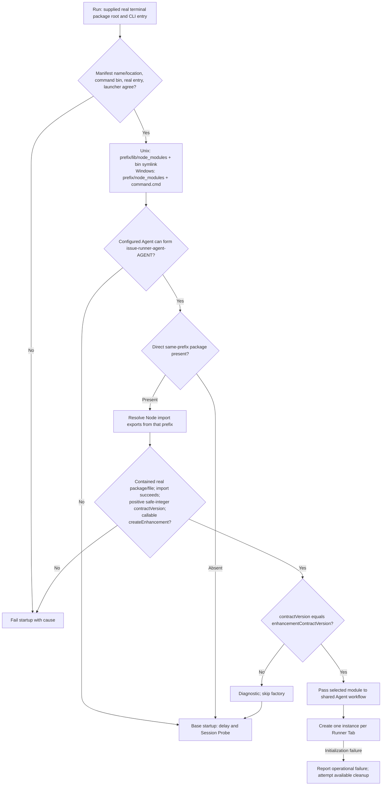
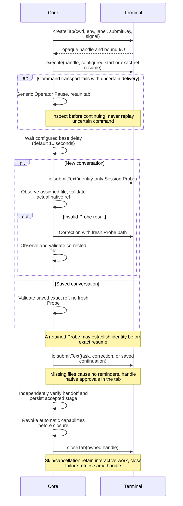
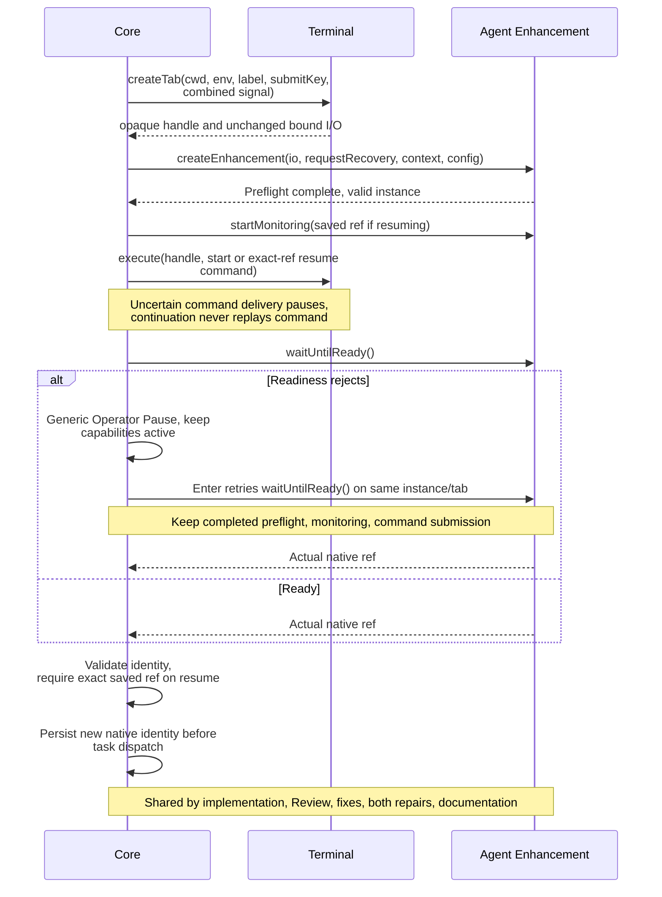
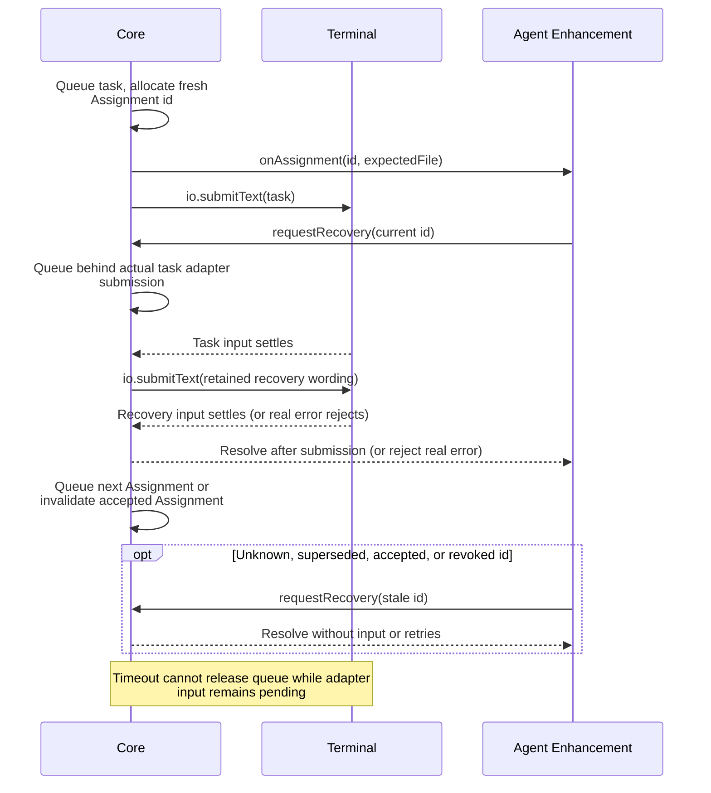
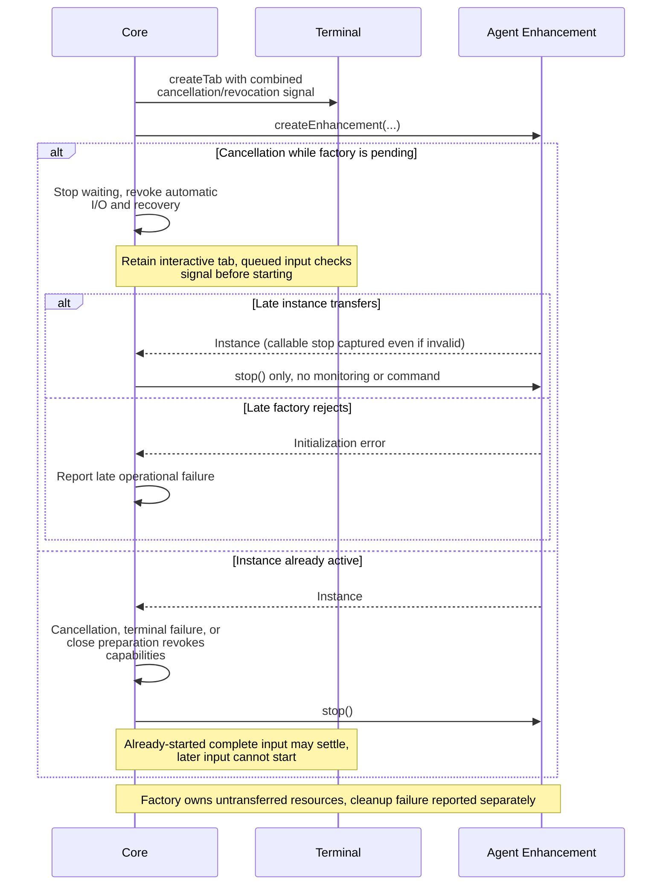
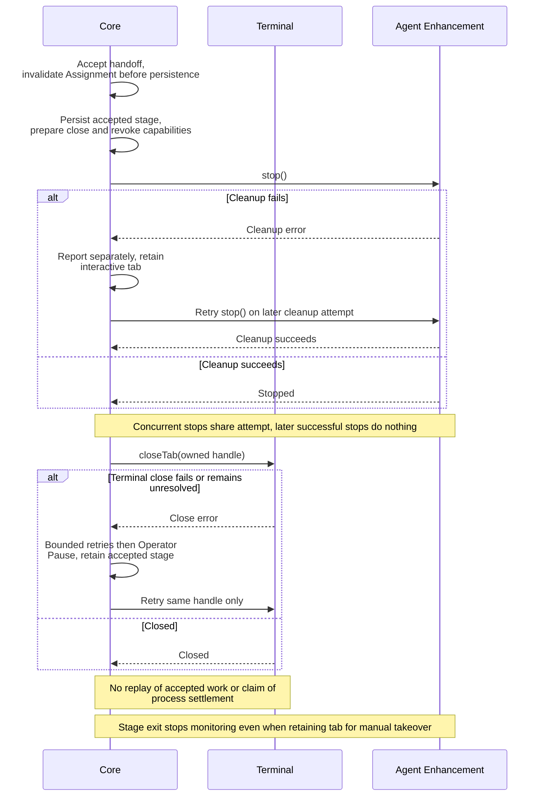

# Public integration contract

## Responsibilities and public entries

```typescript
// Terminal package: executable, command identity, process entry, terminal I/O.
// Core: CLI/workflow policy, Agent selection, Session Probe, native identities,
// handoff validation, Assignments, recovery wording, Operator Pause, and cleanup.
// Agent enhancement: native preflight, monitoring, readiness, recovery requests.
// Base startup requires no enhancement. No legacy or mixed-contract overloads.

// Terminal commands import runCli at runtime: keep Core in dependencies.
import { runCli, type CliOptions } from "issue-runner-core/cli";
import {
  terminalContractVersion, // 2; independent of npm package version
  enhancementContractVersion, // 2; independent of terminal contract version
} from "issue-runner-core/terminal";
// Type-only enhancement consumers can keep Core in devDependencies.
import type {
  TerminalPluginModule, TerminalPlugin, TerminalIO,
  CreateTabOptions, TabHandle, EnhancementModule, Enhancement,
  EnhancementContext, RequestRecovery,
} from "issue-runner-core/terminal";
// No root, source-internal, terminal/testing, or cli/testing public entry.
// Build/check commands and consumer verification: ../README.md#developing-core.
```

## Terminal CLI integration

```typescript
export interface CliOptions {
  commandName: string; // Executing terminal-owned command, used in help/errors.
  commandVersion: string; // Executing terminal package version.
  terminal: TerminalPluginModule; // Lazy factory; import must not create tabs.
  terminalPackageRoot: string; // Absolute real path to installed terminal package.
  terminalCliEntry: string; // Absolute real path to its executing CLI entry.
}
export function runCli(options: CliOptions): Promise<void>;

// Import is inert: no command, terminal creation, or signal listeners.
// Invocation reads process argv/cwd/env, owns operator and AbortController,
// installs SIGINT/SIGTERM abort listeners, and removes them in finally.
// Sets process.exitCode: 0 for success, 1 for handled failure/cancellation;
// never forces process termination. A pending terminal factory is awaited
// before the cancellation checkpoint. Reports/retained resources belong to Core.
// Help/version/init need no credentials or factory; init refuses overwrite.
// Version: <commandName> <commandVersion> (core <loadedCoreVersion>).
// For Runs: arguments, selection, config, credentials, prompts, and nonempty
// Issue List validation precede terminal creation. Module/version/factory and
// result-method validation plus cancellation precede audit and delivery effects.
// Command name, exact argv, and validated config bytes identify recovery input;
// command/Core versions and installation paths do not affect that hash.
// executeCli/CliDependencies/CliResult are internal. No --env/module-path option.
```

```typescript
// Minimal executable at the terminal package root; adapt root for a bin/ entry.
import { realpathSync } from "node:fs";
import { fileURLToPath } from "node:url";
import { runCli } from "issue-runner-core/cli";
import * as terminal from "./terminal.js";

await runCli({
  commandName: "generic-terminal",
  commandVersion: "1.0.0",
  terminal,
  terminalPackageRoot: realpathSync(fileURLToPath(new URL(".", import.meta.url))),
  terminalCliEntry: realpathSync(fileURLToPath(import.meta.url)),
});
```

## Terminal interfaces and bound I/O

```typescript
export const terminalContractVersion = 2 as const;
export type TabHandle = object;
// Opaque, plugin-instance-owned control reference. Core never inspects,
// serializes, persists, or reconstructs it. It is not a native conversation ref.

export interface TerminalPluginModule {
  readonly contractVersion: typeof terminalContractVersion;
  createTerminalPlugin(config: unknown): Promise<TerminalPlugin>;
}
// Core calls the factory once with the complete terminalPlugins mapping and
// generic defaults. Preserve adapter-owned fields; do not inspect factory arity.
// Version/method mismatches, invalid results, and factory failures fail startup
// with command context and useful causes; no workflow side effects precede them.

export interface CreateTabOptions {
  cwd: string; // Absolute working directory; never silently redirect.
  env: Readonly<Record<string, string>>; // Overlay on inherited environment.
  label: string;
  submitKey: string; // Effective Agent chord, defaulted to Enter by Core.
  signal?: AbortSignal; // Run cancellation combined with local revocation.
}
// Reject invalid context or unsupported environment application.
// Creation starts no Agent. Bind cwd/env/key/signal to this Runner Tab.

export interface TerminalPlugin {
  createTab(options: CreateTabOptions):
    Promise<{ handle: TabHandle; io: TerminalIO }>;
  execute(handle: TabHandle, command: string): Promise<void>;
  closeTab(tab: TabHandle): Promise<void>;
}
// execute: complete opaque shell command, then Right and Enter.
// Resolution means submitted, not process exit or Agent readiness.
// Core supplies start unchanged; resume replaces every literal {sessionref}
// with the exact saved native ref, preserving whitespace/replacement characters.
// No separate Agent selector or native identity is passed to the terminal.
// closeTab targets only the owned logical tab. Foreign handles/backend failures
// reject; a target known absent may succeed. Closure does not prove descendants
// settled. Never select a replacement target or replay uncertain input.
```

```typescript
export interface TerminalIO {
  read(): Promise<string>; // Current visible plain-text screen.
  submitText(text: string): Promise<void>; // Entire body, Right, bound submitKey.
  sendKeys(keys: readonly string[]): Promise<void>; // Ordered logical chords.
}
// Bound to one tab; no per-call key override, expected file, or recovery text.
// Core normalizes text to LF, preserving Unicode, quotes, indentation, blanks,
// and literal characters. Unsupported chords reject without fallback.
// I/O grants enhancements neither command execution nor tab-closure capability.
// Core serializes its operations per tab; independent tabs may run concurrently.
// Assignment changes/recovery stay queued until actual adapter input settles,
// including the adapter's own queue. Core timeouts do not release that ordering.
// Adapters check the creation signal when queued input begins: revoked work
// sends nothing. An already-started complete text/key sequence may settle.
// Keep finite backend I/O bounds. Revocation does not roll back existing effects
// or hide real backend errors. Core bounds terminal calls to 60 seconds, while
// cancellation stops its waits; neither proves underlying work was cancelled.
```

## Enhancement discovery and compatibility

Discovery uses the executing terminal command's verified global npm prefix, including when Core is nested. It loads modules; it creates no instances.



Scoped terminal packages and command names differing from package names are supported. Help, version, and init skip discovery. Project-local packages, task cwd, other prefixes, and Core's installation are not discovery anchors. Symlink escapes, dangling installs, malformed exports, and import failures are errors. Compatibility checks use contract versions, not npm versions. Module import executes top-level code; validation is not a sandbox.

## Enhancement interfaces

```typescript
export const enhancementContractVersion = 2 as const;
export type RequestRecovery = (assignmentId: string) => Promise<void>;
export interface EnhancementContext {
  readonly cwd: string;
  readonly env: Readonly<Record<string, string>>;
}
export interface EnhancementModule {
  readonly contractVersion: typeof enhancementContractVersion;
  createEnhancement(
    io: TerminalIO,
    requestRecovery: RequestRecovery,
    context: EnhancementContext,
    config: unknown,
  ): Promise<Enhancement>;
}
// Core passes the adapter's unchanged bound I/O, a SEPARATE recovery capability,
// the tab's cwd/env, and the entire terminalPlugins.enhancements object unchanged
// (default {}). Agent selection chooses the module, not a configuration namespace.
// Factory preflight completes before monitoring and command submission.
// Factories own resources until transferring an instance; a late transfer is
// cleanup-only. Invalid instances still receive stop() if it is callable.
```

```typescript
export interface Enhancement {
  startMonitoring(sessionref?: string): Promise<void>;
  waitUntilReady(): Promise<string>;
  onAssignment(assignment: { id: string; expectedFile: string }): void;
  stop(): Promise<void>;
}
// startMonitoring precedes command submission; resume receives the saved ref.
// waitUntilReady is repeatable. Return actual native identity; Core validates it,
// rejects empty/latest/last/Run/execution IDs, and requires exact resume equality.
// Core alone persists native identity; TabHandle never identifies a conversation.
// onAssignment is synchronous, immediately before input: fresh id for every task,
// continuation, correction, and applicable Probe, even if expectedFile repeats.
// Readiness markers and recovery input do not allocate Assignments.
// requestRecovery accepts only the current live Assignment; resolves after actual
// adapter submission and rejects real input errors. Stale requests succeed silently.
// Core retains expectedFile/recovery wording; acceptance invalidates the Assignment
// before persistence and closure. Readiness rejection alone does not revoke I/O.
// stop releases enhancement resources, not the interactive Agent, other tabs,
// or shared package infrastructure. Successful stop is idempotent; failed stop
// can retry. Concurrent stops share an attempt. Operational and cleanup errors
// are reported separately; prior readiness/input failures do not prevent cleanup.
// Skip, exit, and cancellation retain the interactive tab. Core validates all
// four methods before use. Readiness has no separate Core startup timeout.
```

## Lifecycle and failure flows

### Base startup and exact resume



### Enhanced startup, resume, and readiness retry



### Assignment serialization, recovery, and stale requests



### Cancellation, revocation, and late initialization



### Cleanup failure, retry, and closure


